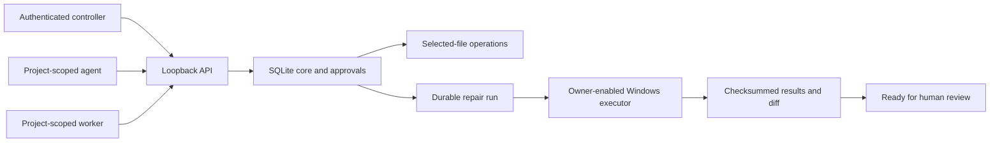
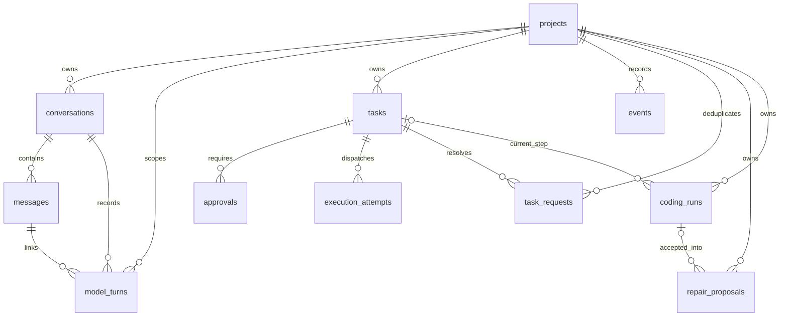

# Jarvis — Architecture

Last maintained: 2026-10-15. This is the canonical current architecture and database record. Update it in place when implementation changes; keep historical detail in Git.

## Product and component boundaries

Jarvis is an internal Windows coordinator with future mobile control and optional hosted operation. The product monorepo owns desktop, core, agent runtime and coding worker. Shared Google/GitHub/social/messaging/document/media/quality/incident projects remain reusable independent repositories. [Repository catalogue](../../REPOSITORIES.md).

| Component | Current state | Responsibility |
|---|---|---|
| `services/core/src/jarvis_core` | Implemented | SQLite state, actor/project policy, approvals, tasks, local API and durable coding runs. |
| `workers/coding/src/skyra_coding` | Implemented | Selected-file snapshots, guarded edits, verification, native execution and controller-supplied repair workflow. |
| `apps/desktop` | Native control slice implemented | Tauri/Rust bridge and tray; React/TypeScript/React Flow subsystem canvas, permissions, proposals, approvals, runs/evidence and stored conversation history. Dedicated Jarvis design. Installer and full agent workspace remain pending. |
| `packages/agent-runtime` | Bounded repair runtime implemented | Explicit Gemini/Groq generation, selected-file context, trusted versioned skills and controller-reviewed patch proposals. Durable chat/draft planning also implemented; general tool selection and build orchestration remain pending. |
| Legacy `main.py`, `core`, `services`, `tools`, `integrations`, `static` | Existing prototype | Original assistant, voice, Telegram, model adapters, memory and UI. It is not connected to the new core policy/worker architecture. |

The existing prototype stays at its launch/import paths until a tested packaging/data migration. Do not move user memory, virtual environments or static assets solely to match a proposed tree.

## Implemented control flow



Controller config determines identities and grants; request payloads cannot select their own actor. Controller creates repair plans and decides approvals. Agents cannot approve, expand scope, claim or self-complete work. Workers cannot change policy or reconcile uncertain effects. Credentials are independent random bearer tokens; server config stores SHA-256 digests. Rotation currently requires a registry change plus restart. Employee/team roles remain pending.

## Technology and runtime

Current implementation: Python standard-library SQLite; FastAPI/Pydantic/Uvicorn local transport; Windows Job Objects for native process supervision. Direct API pins are in [requirements-api.txt](../services/core/requirements-api.txt). These are not a full transitive lock. Proposed desktop stack: Tauri 2, React, TypeScript, Vite and React Flow. Online models come first; future local providers must keep the same authorization boundary.

Local API binds `127.0.0.1:8010`, rejects browser Origin/fetch callers, untrusted Host headers and non-loopback clients, and ignores proxy identity headers. All endpoints require header authentication. Bodies are bounded JSON with a read deadline; errors use sanitized codes and server request IDs. A future native desktop bridge owns privileged calls. Mobile access requires a separate secure transport; do not expose this port publicly.

## Database architecture and data ownership

Core owns projects, conversations, messages, policy versions, tasks, approval state, events and coding runs. Filesystem state owns snapshot files/baselines and checksum-addressed reports. Credential registry and OS credential storage are separate concerns. Legacy Qdrant/JSON conversation storage has not been migrated into this core.

SQLite uses foreign keys, WAL, `synchronous=FULL`, a five-second busy timeout and `BEGIN IMMEDIATE` for state transitions. Production local state defaults to `%LOCALAPPDATA%/Skyra/Jarvis/core.sqlite3`, outside the synced repository. No shared/network SQLite file. Hosted PostgreSQL is a future tested migration, not a current dependency.



### Implemented SQLite schema — version 8

Derived from `services/core/src/jarvis_core/store.py`, including migrations. These are current tables, not a proposed schema. IDs and validation are supplied by the application; there are no invented database CHECK constraints.

#### `approvals`

| Column | SQLite type | Declared constraint |
|---|---|---|
| `id` | `TEXT` | primary-key position 1 |
| `task` | `TEXT` | NOT NULL |
| `version` | `INTEGER` | NOT NULL |
| `digest` | `TEXT` | NOT NULL |
| `expires` | `REAL` | NOT NULL |
| `state` | `TEXT` | NOT NULL |

Foreign keys: `task` → `tasks.id`.

Indexes:

```sql
CREATE INDEX approvals_task ON approvals(task,version);
```

#### `coding_runs`

| Column | SQLite type | Declared constraint |
|---|---|---|
| `id` | `TEXT` | primary-key position 1 |
| `project` | `TEXT` | NOT NULL |
| `resource` | `TEXT` | NOT NULL |
| `plan` | `TEXT` | NOT NULL |
| `owner` | `TEXT` | NOT NULL |
| `state` | `TEXT` | NOT NULL |
| `position` | `INTEGER` | NOT NULL |
| `task` | `TEXT` | No explicit NOT NULL/default constraint |
| `results` | `TEXT` | NOT NULL |
| `request_id` | `TEXT` | No explicit NOT NULL/default constraint |

Foreign keys: `task` → `tasks.id`, `project` → `projects.id`.

Indexes:

```sql
CREATE UNIQUE INDEX coding_resource_active ON coding_runs(project,resource) WHERE state NOT IN ('failed','ready_for_review','cancelled');
CREATE UNIQUE INDEX coding_run_request ON coding_runs(project,request_id);
```

#### `conversations`

| Column | SQLite type | Declared constraint |
|---|---|---|
| `id` | `TEXT` | primary-key position 1 |
| `project` | `TEXT` | NOT NULL |

Foreign keys: `project` → `projects.id`.

#### `events`

| Column | SQLite type | Declared constraint |
|---|---|---|
| `id` | `INTEGER` | primary-key position 1 |
| `project` | `TEXT` | NOT NULL |
| `kind` | `TEXT` | NOT NULL |
| `subject` | `TEXT` | NOT NULL |
| `at` | `REAL` | NOT NULL |

Foreign keys: `project` → `projects.id`.

Indexes:

```sql
CREATE INDEX events_project_cursor ON events(project,id);
```

#### `execution_attempts`

| Column | SQLite type | Declared constraint |
|---|---|---|
| `task` | `TEXT` | primary-key position 1, NOT NULL |
| `token` | `TEXT` | primary-key position 2, NOT NULL |

Foreign keys: `task` → `tasks.id`.

#### `messages`

| Column | SQLite type | Declared constraint |
|---|---|---|
| `id` | `INTEGER` | primary-key position 1 |
| `conversation` | `TEXT` | NOT NULL |
| `role` | `TEXT` | NOT NULL |
| `content` | `TEXT` | NOT NULL |
| `request_id` | `TEXT` | NOT NULL |

Foreign keys: `conversation` → `conversations.id`.

#### `projects`

| Column | SQLite type | Declared constraint |
|---|---|---|
| `id` | `TEXT` | primary-key position 1 |
| `owner` | `TEXT` | NOT NULL |
| `name` | `TEXT` | NOT NULL |
| `mode` | `TEXT` | NOT NULL |
| `version` | `INTEGER` | NOT NULL |
| `resources` | `TEXT` | NOT NULL |

Foreign keys: none.

#### `task_requests`

| Column | SQLite type | Declared constraint |
|---|---|---|
| `project` | `TEXT` | primary-key position 1, NOT NULL |
| `request_id` | `TEXT` | primary-key position 2, NOT NULL |
| `digest` | `TEXT` | NOT NULL |
| `task` | `TEXT` | NOT NULL |

Foreign keys: `task` → `tasks.id`, `project` → `projects.id`.

#### `tasks`

| Column | SQLite type | Declared constraint |
|---|---|---|
| `id` | `TEXT` | primary-key position 1 |
| `project` | `TEXT` | NOT NULL |
| `action` | `TEXT` | NOT NULL |
| `resource` | `TEXT` | NOT NULL |
| `payload` | `TEXT` | NOT NULL |
| `digest` | `TEXT` | NOT NULL |
| `state` | `TEXT` | NOT NULL |
| `lease_token` | `TEXT` | No explicit NOT NULL/default constraint |
| `lease_until` | `REAL` | No explicit NOT NULL/default constraint |
| `policy_version` | `INTEGER` | No explicit NOT NULL/default constraint |
| `evidence` | `TEXT` | No explicit NOT NULL/default constraint |

Foreign keys: `project` → `projects.id`.

Indexes:

```sql
CREATE INDEX tasks_recovery ON tasks(project,state,lease_until);
```


### Storage semantics and constraints

- `projects.resources`, task payload/evidence and coding-run plan/results are JSON encoded in TEXT. Validation belongs to the current application; future migrations may normalize fields where useful.
- Project policy defaults to read-only with no resources. Full mode is bounded by exact logical resource IDs, not global administrator access.
- Task intent hashes bind actor, project, action, resource and canonical payload. Approval binds that digest, policy version and expiry; consumption is single-use. A changed policy invalidates an earlier decision.
- Message deduplication is per conversation/request ID; task and run deduplication are per project/request ID. Reusing a key with different input conflicts.
- `execution_attempts` prevents dispatching the same lease twice. `coding_resource_active` prevents concurrent active repair runs on the same project/resource.
- Events have monotonically increasing SQLite IDs and replay cursors; they reference subjects rather than duplicating message content. This is not yet a complete multi-user audit schema with separate approver identity fields.
- Long execution uses bounded leases and periodic heartbeats, not a held SQLite transaction. File effects cannot roll back with database state. Unknown effects become interrupted and need explicit reconciliation.
- Native/container test outputs and diffs are referenced by SHA-256; evidence lookup checks ownership, attachment and checksum. Private filesystem access controls remain necessary. Runtime artifacts are ignored by Git.

### Proposed future entities — not implemented

| Entity | Intended fields/relationship |
|---|---|
| MemoryRevision | project/actor scope, teaching, source/provenance, revision, superseded_by, retention; search entries reference revisions. |
| Artifact | project/run/task ID, location reference, checksum, format, verification status and retention. Current artifacts are filesystem reports with task evidence references. |
| SpecificationVersion | project, requirement document checksum, version, approved scope; build runs bind to a reviewed version. |
| SkillInstallation | version, source checksum, capabilities, required grants and evaluation status. |
| Schedule | timezone, due time, job template, policy version, deduplication/lease state. |
| DevicePairing | actor/device, revocable credentials, grants, expiry and last connection. |

Do not mark these built or invent deployed tables. Define migration and retention/export rules before implementation. No live customer/employee data belongs in examples.

## Worker and execution boundaries

The trusted host registers `(project, resource)` to a selected-file snapshot. Snapshot limits are 100 UTF-8 text files, 1 MiB each, 10 MiB total. Unselected files, traversal, known secrets, hard links, symlinks/reparse points and alternate data streams are rejected. Patches require a current content hash and exactly one anchor. Baseline and evidence sit outside editable files. Source repository, Git index and user changes are not modified by delivery.

Native mode requires explicit owner enablement and fixed profiles for trusted projects. It carries the Windows account's file/network access and is not a security sandbox. A reduced inherited environment limits accidental token propagation but cannot prevent code from reading accessible host files. Suspended process launch ensures Job Object assignment before project code starts; timeout, ordinary child cleanup and output bounds are verified. Service-launched unrelated processes and hostile same-account code are outside that supervision guarantee.

Optional Docker adapter requires reviewed digest-pinned images, no automatic pulls, no network, read-only selected-file mount, dropped capabilities, non-root user and resource limits. Only configuration contracts are tested here; no live Docker engine exists on this PC. There is no silent backend fallback.

## Durable repair workflow

Controller supplies an immutable repair plan. Sequence: failing baseline test → explicit patches → passing retest through the same protected profile → diff. Ask-mode pauses are persisted. Plans cannot edit protected tests. Runtime/cleanup failures do not count as a reproduced test failure. Only matching task-bound execution evidence can satisfy the final gate. Completion is `ready_for_review`, never automatic push/deploy or universal production readiness.

Plans may now originate from a validated Gemini/Groq proposal that the controller accepts. Worker advance handles one step; an always-on scheduler is not implemented. Restart checkpoints between completed steps and duplicate request/dispatch handling are verified. Active effects after a machine crash require reconciliation.

## Launch, recovery and operations

### Configuration ownership

Authentication registry is a private JSON array of entries with `token_sha256` (64 lowercase hex characters), `actor`, `role` (`controller`, `agent`, `worker`) and `projects` (explicit IDs for agent/worker). Raw bearer tokens are independently generated, for example using `secrets.token_urlsafe(32)`, and belong in protected client storage. The model never receives controller credentials. No permanent credentials were generated by the implementation tests.

Trusted workspace configuration has this structure; substitute real absolute paths, project IDs and an already-installed executable:

```json
{
  "evidence_root": "C:/private/jarvis/evidence",
  "workspaces": [
    {"project_id": "<project-id>", "resource_id": "workspace:run-1", "directory": "C:/private/jarvis/snapshot"}
  ],
  "execution": {
    "mode": "native_trusted",
    "owner_enabled": true,
    "profiles": [
      {
        "name": "python-unit",
        "argv": ["C:/path/to/python.exe", "-B", "-m", "unittest", "discover", "-s", "tests", "-v"],
        "protected_paths": ["tests/test_app.py"],
        "timeout": 120
      }
    ]
  }
}
```

Profiles are owner configuration, not model arguments. Without an execution section the worker supports files/static checks only. Docker mode uses `mode: docker`, a fixed `context` and profiles with `name`, digest-pinned `image`, fixed `argv`, `protected_paths` and `timeout`; it never silently falls back to native mode. Protect config writes using OS account permissions. Native mode is an explicit trust choice, not implied by full project policy.

Developer launch: `venv/Scripts/python.exe services/core/run.py --auth-config <private registry> --workspace-config <trusted workspace registry>`. The workspace registry selects explicit native or Docker profiles; no registration endpoint grants arbitrary directories to model input. Protect registry writes as authorization decisions. There is no completed hidden desktop supervisor or installer yet.

Test with the core and worker suites listed in [development](DEVELOPMENT.md). The repeatable `workers/coding/repair_demo.py --directory <new directory>` uses generated trusted fixtures, no model calls and no Git writes. The demo's repair bundle is ignored runtime data, not a new permanent Markdown report.

Backup/restore, data export/deletion, migrations to hosted storage, credential-store integration and operational telemetry remain release gates. API security and file checks do not make the legacy direct-shell tools safe or governed by this architecture.

## Coding-engine performance direction — planned

Public patterns from [Claude Code](https://code.claude.com/docs/en/how-claude-code-works), [Codex App Server](https://learn.chatgpt.com/docs/app-server), [OpenCode](https://opencode.ai/docs/server/), [Antigravity](https://antigravity.google/docs/artifacts) and [Cursor's historical edit research](https://cursor.com/blog/instant-apply) inform the design; they do not establish private internals or a superiority claim. Keep the engine independent of clients, retrieve targeted context, load skills/tools progressively, preserve warm connections, apply hash-checked edits and parallelize only independent work. Optional code intelligence must be benchmarked; indexes can become stale.

Use fast/balanced/thorough effort profiles without bypassing permissions or required verification. Small edits should not always pay for planner/critic/reviewer model calls. Measure first useful response, first valid edit, end-to-end verified completion, cost per accepted task, regressions, retries and human intervention. Use at least 30 representative tasks plus a held-out set, identical starting snapshots, recorded model/tool/effort/cache settings and independent acceptance. A provisional 20% median speed improvement target is a goal, not a measured claim. Required correctness and policy-failure rates cannot regress to make a speed number look better.

## Architecture decisions and implementation changes

| Date | Decision/change | Current result |
|---|---|---|
| 2026-10-14 | Jarvis monorepo; independent reusable service repositories | Desktop/runtime/coding specifications live in Jarvis; foundation lives with contracts. |
| 2026-10-14 | Local durable core and authenticated roles | Implemented; current SQLite schema 5 includes request and execution ownership. |
| 2026-10-14 | Selected snapshots and approved file operations | Implemented; original source and Git state preserved. |
| 2026-10-14 | Owner selected trusted native execution first | Real Windows repair workflow verified; native access is explicitly labelled. |
| 2026-10-14 | Optional isolated execution | Docker adapter prepared; live isolation verification remains pending. |
| 2026-10-14 | Consolidated maintained documentation | Architecture/database/decisions here; functionality and development maintained alongside it. No per-change Markdown reports. |

## Initial specification set

Retain and update the original nine documents. They describe product requirements, system architecture, development rules, design, tasks, memory, API/events, testing/acceptance and security/operations. These current overview files supplement them; they do not replace them.

- [Product requirements](01_PRODUCT_REQUIREMENTS.md)
- [System architecture](02_SYSTEM_ARCHITECTURE.md)
- [Development rules](03_DEVELOPMENT_RULES.md)
- [Design system](04_DESIGN_SYSTEM.md)
- [Project tasks](05_PROJECT_TASKS.md)
- [Project memory](06_PROJECT_MEMORY.md)
- [API and event contracts](07_API_AND_EVENTS.md)
- [Testing and acceptance](08_TESTING_AND_ACCEPTANCE.md)
- [Security and operations](09_SECURITY_AND_OPERATIONS.md)

## Model proposal runtime and database migration 6

Source: `packages/agent-runtime/src/jarvis_runtime`; optional direct SDK pins: `packages/agent-runtime/requirements.txt`. Core remains the owner of all durable orchestration state. No LangGraph dependency is required for this bounded state machine.

`repair_proposals` columns: `id TEXT PRIMARY KEY`, `project TEXT NOT NULL REFERENCES projects(id)`, `request_id TEXT NOT NULL`, `digest TEXT NOT NULL`, `resource TEXT NOT NULL`, `profile TEXT NOT NULL`, `provider TEXT NOT NULL`, `model TEXT NOT NULL`, `state TEXT NOT NULL`, `context TEXT NOT NULL`, nullable `response TEXT`, `usage TEXT`, `error TEXT`, `run TEXT REFERENCES coding_runs(id)`, and `created REAL NOT NULL`; unique `(project,request_id)`. Existing version-5 projects/conversations/tasks/runs are preserved by migration. JSON fields are application-validated TEXT; no additional CHECK constraints are claimed.

States: planned → generating → ready → accepted; generation failure → failed; controller interruption from planned/generating/ready → interrupted. A generating request is never automatically resent after restart. The controller can interrupt an uncertain generation and explicitly create a new request ID. Interruption does not cancel a provider-side request or reverse its cost; late responses cannot revive it. Acceptance and run creation share one SQLite transaction. Provider calls hold no database transaction. The existing worker still advances each run step explicitly.

Context is explicitly selected (1–20 files, ≤96 KB serialized UTF-8 including goal/skills/schema). It stores goal, source text/hashes, protected flags, trusted skill name/version/instructions/checksum, response schema and test-profile checksum. Review rechecks current file hashes, resource grants and test profile. Output is bounded (≤64 KB), strict local JSON with one unique anchor replacement per file and 1–10 patches. Paths must be in context; protected tests, stale hashes, duplicate paths, unknown fields and ineffective edits are rejected. Request idempotency binds caller intent, preserving the first context on repeated creation.

Gemini uses structured JSON output; Groq uses JSON object mode plus the same local semantic validation. Both use official SDKs, fixed configured models, bounded timeout/output tokens and one attempt. They receive no tools, controller credentials, workspace paths or execution keys. Provider errors are sanitized into fixed codes, optionally an allowlisted HTTP status. Safe usage counts remain recorded even when patch validation fails; unknown usage remains null. These are token counts, not currency billing records. Raw exceptions, invalid model responses and private reasoning are not stored.

Trusted startup adds `--runtime-config <private-json-path>` alongside `--workspace-config`. The shape is in [config.example.json](../packages/agent-runtime/config.example.json). Provider entries contain environment variable names, never key values; startup does not implicitly load repository `.env` or rotate/fallback keys. Existing legacy `.env` can be used explicitly by the generated-fixture demo only. SDKs are optional when the runtime is disabled. Private SQLite contains selected source and goals: use local app-data access controls, backups and retention policy. Secret filename filtering cannot detect arbitrary secrets embedded in otherwise allowed source; the controller must review selections before generation. This milestone adds no new encryption or remote data-retention guarantee.

The first skill is trusted `minimal-repair` guidance configured by the host. Skills have no executable hooks and cannot grant permissions. Skill auto-discovery, teaching storage, search embeddings, full planning/delegation, cost ceilings, broad project creation and always-on scheduling are future work.

Official adapter references: [Gemini generation API](https://ai.google.dev/api/generate-content), [Groq JSON/structured output](https://console.groq.com/docs/structured-outputs), [Groq SDK retry settings](https://github.com/groq/groq-python#retries).

## Windows control centre — implemented slice

`apps/desktop` owns a Tauri 2 Rust host and React/TypeScript/Vite/React Flow interface, with no Skyra Platform UI dependency. Exact JS dependencies are locked in `pnpm-lock.yaml`; Rust dependencies in `src-tauri/Cargo.lock`, with Rust 1.99.0 pinned. Current direct stack: React 19.3.1, React Flow 12.12.0, Vite 8.3.4, TypeScript 7.0.2, Tauri API/crate 2.12.3 and CLI 2.12.2. React state is sufficient for this bounded slice; the proposed TanStack Query/Zustand adoption is deferred until their caching/layout responsibilities are needed.

Renderer → allowlisted Tauri `core_request` → native fixed-loopback HTTP client → existing core policy/workflow. The renderer supplies an operation and validated IDs, never a URL, bearer token or shell command. Native host owns a controller credential and an optional separate project-scoped worker credential; only run advancement uses the worker token. Unknown actions/fields, non-UUID IDs and invalid artifact checksums are rejected. Proxies, redirects and retries are disabled; requests/responses/timeouts are bounded (128 KiB request, 2 MiB response, 125 seconds overall). The renderer cannot call the core directly; browser Origin restrictions are unchanged. Browser `?preview=1` is explicitly fixture-only and cannot contact the core; it is disabled inside Tauri.

Trusted desktop configuration defaults to `%LOCALAPPDATA%/Skyra/Jarvis/desktop.json` (or host-set `JARVIS_DESKTOP_CONFIG`), with `port`, `controller_token_dpapi` and optional `worker_token_dpapi`. Token ciphertext is user-bound Windows DPAPI, not renderer storage. `bootstrap.py` initializes a new private state directory, hashed core auth registry and launcher config; it refuses existing state and enables no worker, native execution or provider by default. Paths/test commands/model keys still require trusted host configuration. DPAPI does not isolate hostile code running as the same Windows user.

`launch.pyw` uses an authenticated local health check, rejects redirects and starts an owned Python core with CREATE_NO_WINDOW only when needed. It opens the GUI release executable and stops only that owned core when the application exits. Closing the window hides to the tray; the tray has Open and Exit. A second launch restores the existing window. Release binaries use the Windows GUI subsystem. No automatic startup at login, crash supervisor, signed installer/updater or bundled Python backend is claimed. Tray Exit can interrupt active effects; recovery/reconciliation remains explicit through the core.

`GET /v1/projects/{project}/dashboard` is controller-only and derives bounded current state: project policy, conversation counts, recent proposals/runs, pending approvals with server-derived validity, permitted workspace filenames, registered logical resource IDs, worker/runtime capabilities and recent events. It includes no leases, raw tokens, message bodies, proposal source or task payloads. The UI fetches exact details separately. The first desktop control slice added no database tables. The subsequent conversation/planning slice advances SQLite to version 7 as described below. Policy updates optionally accept `expected_version`; the UI always supplies the reviewed version to prevent lost updates. Saving a policy increments its version and invalidates earlier approvals.

The UI polls the current project every ten seconds while visible/idle; it does not advance workflows automatically. Long-request cancellation/interruption has an independent control request lane, so it remains available while advance/generation is pending. Recent lists are bounded at 100 items, events at 50; message reads use ten-message cursor pages. Native model/API results remain plain text/structured JSON; no model-supplied HTML is executed. Optional subsystem nodes are marked planned/unavailable until actually integrated. Canvas is a capability/connection map, not an executable workflow authoring engine.

Upstream implementation references: [Tauri native commands](https://v2.tauri.app/develop/calling-rust/), [capabilities](https://v2.tauri.app/security/capabilities/), [system tray](https://v2.tauri.app/learn/system-tray/), [single instance](https://v2.tauri.app/plugin/single-instance/), [React Flow](https://reactflow.dev/learn).

## Conversation and draft planning architecture

### `model_turns` — migration 7

| Column | SQLite type | Constraint / meaning |
|---|---|---|
| `id` | `TEXT` | primary key |
| `conversation` | `TEXT` | NOT NULL; conversations.id |
| `project` | `TEXT` | NOT NULL; projects.id |
| `request_id` | `TEXT` | NOT NULL |
| `digest` | `TEXT` | NOT NULL; intent checksum |
| `provider` | `TEXT` | NOT NULL; registered alias |
| `model` | `TEXT` | NOT NULL; exact model |
| `mode` | `TEXT` | NOT NULL; chat or plan |
| `state` | `TEXT` | NOT NULL |
| `context` | `TEXT` | NOT NULL; JSON snapshot |
| `response` | `TEXT` | nullable; validated JSON |
| `usage` | `TEXT` | nullable; bounded token counts |
| `error` | `TEXT` | nullable; safe code only |
| `user_message` | `INTEGER` | NOT NULL; messages.id |
| `assistant_message` | `INTEGER` | nullable; messages.id |
| `created` | `REAL` | NOT NULL; timestamp |

Unique `(conversation, request_id)` binds retry identity to a SHA-256 intent digest. The partial unique index `conversation_model_active` on conversation applies while state is planned or generating. States are planned → generating → completed/failed, or planned/generating → interrupted. Other terminal states are never redispatched. Generating state after a crash means uncertain; the owner must inspect/interrupt it, not retry the paid call.

Creation atomically snapshots the recent contiguous history suffix, current request, explicit response schema and trusted instruction version/hash, inserts the user message, creates the turn and emits events. History is at most 30 complete messages; total encoded context is bounded below 48 KB. Oversized current requests fail before persistence. Older messages remain in SQLite and the UI shows the omitted count. No project files, workspace paths, keys or tool outputs are automatically added.

Generation atomically claims planned state, releases the transaction before the network call and makes one provider attempt. The same registered alias, provider family, model, response schema and instruction hash must still match. Gemini receives the schema through its SDK and context; Groq JSON mode receives the schema explicitly in context. Strict local validation rejects duplicate keys, nonfinite JSON, extra fields, executable-shaped fields and incomplete plans. Successful response, usage, assistant message and completion event commit together. Failure stores only a safe code; interruption prevents late output from appending a response. This does not promise to cancel provider billing.

Core provides owner-scoped history and interruption even without provider configuration. Provider setup no longer requires FileWorker: chat-only configurations can load the same trusted runtime JSON. RepairRuntime is registered only when a worker exists. The native Rust bridge exposes fixed controller routes for setup and model turns; renderer code cannot supply transport URLs or credentials.

The setup checklist is read-only configuration guidance. Paths/commands, worker identity, environment secrets and native execution consent remain trusted configuration. Configuration editing, streaming, learned-memory governance, document/file delivery and an approved plan-to-build state machine remain pending.

## Flexible desktop workspace

The React Workspace shell owns per-window tabs and calls App with a controlled view. Up to eight tabs are available per window. Visited tabs remain mounted while hidden to preserve draft/selection state; restored tabs mount only when first activated, and inactive tabs pause dashboard polling. The shell keeps window controls visible and scrolls content inside the available viewport. Native windows retain standard OS decorations for resizing, snapping and moving between monitors. Core and map are separate built-in views as well as overview cards. The orbital object is CSS 3D geometry, not an additional model/runtime or WebGL dependency; animation is opt-in and reduced-motion aware.

Native workspace.rs exposes only two custom commands. open_panel validates a fixed view allowlist plus an optional lowercase 32-hex project ID, generates its own label and builds a local app URL. There are at most eight additional windows. workspace_action controls the invoking window (minimize, maximize, fullscreen, logical width/height), shows open windows, or saves/restores a bounded arrangement. Window capabilities cover main and host-created panel-* labels; they do not expose generic webview creation, remote navigation, shell or filesystem plugins. Existing server authorization remains authoritative across every window.

### UI persistence; Core schema remains 7

- WebView localStorage key jarvis.workspace.v1.<window-label> stores version 1, tab IDs, built-in views, project IDs, minimized flags and active ID. It contains no conversation content or credentials. Corrupt records fall back to one usable Overview tab. Metadata restores automatically; in-memory drafts do not survive restart/closing a tab.
- Explicit Save window arrangement writes versioned window-arrangement.json beside the trusted desktop config when JARVIS_DESKTOP_CONFIG is set; otherwise it uses the native application data directory. It contains labels, built-in view/project metadata, physical normal/current dimensions, positions and maximized state. Writes use a temporary file and replacement. Restore reads at most 32 KB, rejects unknown fields/invalid records/duplicates/more than nine windows, validates views and IDs, then fits geometry to current connected monitor work areas and shows windows. Minimized/fullscreen windows must first return to normal mode before saving.
- Restore is explicit. It repositions existing saved windows and recreates missing saved panels; extra currently open panels are preserved. At the window cap, close unused panels before restoring additional ones. Windows keep independent tab metadata; no durable agent work is replayed by restoring a layout.

Closing main continues to hide to tray. Closing a child destroys only that window. Show all windows unminimizes open windows; tray/second-instance activation unminimizes the main window. Explicit Exit remains the application/core lifecycle boundary. A full dockable grid editor, named arrangement profiles, automatic reopening of all external windows and cross-device layout sync remain future work.


## Versioned specifications and repair handoff - 2026-10-15

Migration 8 adds `project_specs`. Its immutable payload is a canonical JSON map of four host-defined Markdown document names to text: requirements, phased tasks, acceptance criteria and planning record. The source is a completed `plan` model turn in the same project. No additional provider call or repository filesystem write occurs. Missing architecture/design/security detail is not fabricated.

| Column | SQLite type | Constraint / meaning |
|---|---|---|
| id | TEXT | PRIMARY KEY |
| project | TEXT | NOT NULL, FK projects(id) |
| version | INTEGER | NOT NULL, UNIQUE(project,version) |
| source_turn | TEXT | NOT NULL, FK model_turns(id) |
| request_id | TEXT | NOT NULL, UNIQUE(project,request_id) |
| digest | TEXT | NOT NULL, publication intent SHA-256 |
| sha256 | TEXT | NOT NULL, canonical document bundle SHA-256 |
| documents | TEXT | NOT NULL, immutable canonical JSON |
| state | TEXT | NOT NULL, application-managed draft/approved/superseded |
| created | REAL | NOT NULL, publication time |
| approved | REAL | nullable approval time |

Publication uses BEGIN IMMEDIATE, owner checks, idempotency lookup, completed-plan verification and expected latest-version comparison. Duplicate request IDs with identical intent return the original snapshot; changed intent conflicts. Approving requires the exact checksum and latest version. The same approval is idempotent; a new approval supersedes the prior approved version atomically. Publishing a draft does not revoke existing approval. Lists return at most 100 metadata records. Full documents are retrieved through a separate owner-checked detail route. No new schema CHECK constraints are claimed.

Repair proposal creation accepts optional `specification`. Its intent digest includes that ID; its immutable context embeds the specification ID/version/checksum/documents under the existing 96 KB total context cap. Only an approved version owned by the same project is eligible. Freshness checks before dispatch, after provider completion and during atomic acceptance reject superseded approval. Already accepted runs retain their original fixed repair steps; explicit run cancellation and existing task approvals govern execution. These are selected-file repairs, not a general greenfield build agent.

The Rust bridge adds four fixed controller actions (specifications, publish_specification, specification, approve_specification). Documents are displayed in expandable preformatted text. No generic filesystem/export command, HTML rendering, new service, framework or dependency is added.
