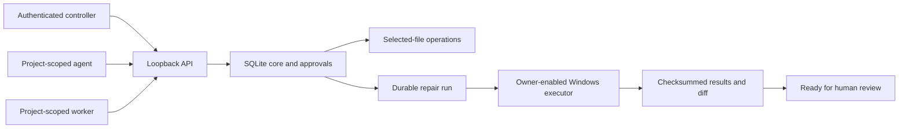
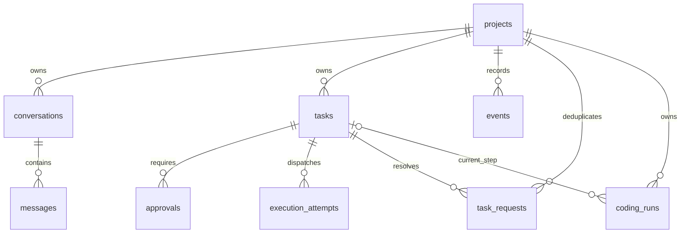

# Jarvis — Architecture

Last maintained: 2026-10-14. This is the canonical current architecture and database record. Update it in place when implementation changes; keep historical detail in Git.

## Product and component boundaries

Jarvis is an internal Windows coordinator with future mobile control and optional hosted operation. The product monorepo owns desktop, core, agent runtime and coding worker. Shared Google/GitHub/social/messaging/document/media/quality/incident projects remain reusable independent repositories. [Repository catalogue](../../REPOSITORIES.md).

| Component | Current state | Responsibility |
|---|---|---|
| `services/core/src/jarvis_core` | Implemented | SQLite state, actor/project policy, approvals, tasks, local API and durable coding runs. |
| `workers/coding/src/skyra_coding` | Implemented | Selected-file snapshots, guarded edits, verification, native execution and controller-supplied repair workflow. |
| `apps/desktop` | Planned | Tauri/React/React Flow Windows interface, tray, approvals, conversations and workflow canvas. Dedicated Jarvis design, not Skyra Platform UI. |
| `packages/agent-runtime` | Planned | Model-driven planning, context/skills, tool selection and patch generation against the execution boundary. |
| Legacy `main.py`, `core`, `services`, `tools`, `integrations`, `static` | Existing prototype | Original assistant, voice, Telegram, model adapters, memory and UI. It is not connected to the new core policy/worker architecture. |

The existing prototype stays at its launch/import paths until a tested packaging/data migration. Do not move user memory, virtual environments or static assets solely to match a proposed tree.

## Implemented control flow



Controller config determines identities and grants; request payloads cannot select their own actor. Controller creates repair plans and decides approvals. Agents cannot approve, expand scope, claim or self-complete work. Workers cannot change policy or reconcile uncertain effects. Credentials are independent random bearer tokens; server config stores SHA-256 digests. Rotation currently requires a registry change plus restart. Employee/team roles remain pending.

## Technology and runtime

Current implementation: Python standard-library SQLite; FastAPI/Pydantic/Uvicorn local transport; Windows Job Objects for native process supervision. Direct API pins are in [requirements-api.txt](../services/core/requirements-api.txt). These are not a full transitive lock. Proposed desktop stack: Tauri 2, React, TypeScript, Vite and React Flow. Online models come first; future local providers must keep the same authorization boundary.

Local API binds `127.0.0.1:8010`, rejects browser Origin/fetch callers, untrusted Host headers and non-loopback clients, and ignores proxy identity headers. All endpoints require header authentication. Bodies are bounded JSON with a read deadline; errors use sanitized codes and server request IDs. A future native desktop bridge owns privileged calls. Mobile access requires a separate secure transport; do not expose this port publicly.

## Database architecture and data ownership

Core owns projects, conversations, messages, policy versions, tasks, approval state, events and coding runs. Filesystem state owns snapshot files/baselines and checksum-addressed reports. Credential registry and OS credential storage are separate concerns. Legacy Qdrant/JSON conversation storage has not been migrated into this core.

SQLite uses foreign keys, WAL, `synchronous=FULL`, a five-second busy timeout and `BEGIN IMMEDIATE` for state transitions. Production local state defaults to `%LOCALAPPDATA%/Skyra/Jarvis/core.sqlite3`, outside the synced repository. No shared/network SQLite file. Hosted PostgreSQL is a future tested migration, not a current dependency.



### Implemented SQLite schema — version 5

Derived from `services/core/src/jarvis_core/store.py`, including migrations. These are current tables, not a proposed schema. IDs and validation are supplied by the application; there are no invented database CHECK constraints.

#### `approvals`

| Column | SQLite type | Declared constraint |
|---|---|---|
| `id` | `TEXT` | primary-key position 1 |
| `task` | `TEXT` | NOT NULL |
| `version` | `INTEGER` | NOT NULL |
| `digest` | `TEXT` | NOT NULL |
| `expires` | `REAL` | NOT NULL |
| `state` | `TEXT` | NOT NULL |

Foreign keys: `task` → `tasks.id`.

Indexes:

```sql
CREATE INDEX approvals_task ON approvals(task,version);
```

#### `coding_runs`

| Column | SQLite type | Declared constraint |
|---|---|---|
| `id` | `TEXT` | primary-key position 1 |
| `project` | `TEXT` | NOT NULL |
| `resource` | `TEXT` | NOT NULL |
| `plan` | `TEXT` | NOT NULL |
| `owner` | `TEXT` | NOT NULL |
| `state` | `TEXT` | NOT NULL |
| `position` | `INTEGER` | NOT NULL |
| `task` | `TEXT` | No explicit NOT NULL/default constraint |
| `results` | `TEXT` | NOT NULL |
| `request_id` | `TEXT` | No explicit NOT NULL/default constraint |

Foreign keys: `task` → `tasks.id`, `project` → `projects.id`.

Indexes:

```sql
CREATE UNIQUE INDEX coding_resource_active ON coding_runs(project,resource) WHERE state NOT IN ('failed','ready_for_review','cancelled');
CREATE UNIQUE INDEX coding_run_request ON coding_runs(project,request_id);
```

#### `conversations`

| Column | SQLite type | Declared constraint |
|---|---|---|
| `id` | `TEXT` | primary-key position 1 |
| `project` | `TEXT` | NOT NULL |

Foreign keys: `project` → `projects.id`.

#### `events`

| Column | SQLite type | Declared constraint |
|---|---|---|
| `id` | `INTEGER` | primary-key position 1 |
| `project` | `TEXT` | NOT NULL |
| `kind` | `TEXT` | NOT NULL |
| `subject` | `TEXT` | NOT NULL |
| `at` | `REAL` | NOT NULL |

Foreign keys: `project` → `projects.id`.

Indexes:

```sql
CREATE INDEX events_project_cursor ON events(project,id);
```

#### `execution_attempts`

| Column | SQLite type | Declared constraint |
|---|---|---|
| `task` | `TEXT` | primary-key position 1, NOT NULL |
| `token` | `TEXT` | primary-key position 2, NOT NULL |

Foreign keys: `task` → `tasks.id`.

#### `messages`

| Column | SQLite type | Declared constraint |
|---|---|---|
| `id` | `INTEGER` | primary-key position 1 |
| `conversation` | `TEXT` | NOT NULL |
| `role` | `TEXT` | NOT NULL |
| `content` | `TEXT` | NOT NULL |
| `request_id` | `TEXT` | NOT NULL |

Foreign keys: `conversation` → `conversations.id`.

#### `projects`

| Column | SQLite type | Declared constraint |
|---|---|---|
| `id` | `TEXT` | primary-key position 1 |
| `owner` | `TEXT` | NOT NULL |
| `name` | `TEXT` | NOT NULL |
| `mode` | `TEXT` | NOT NULL |
| `version` | `INTEGER` | NOT NULL |
| `resources` | `TEXT` | NOT NULL |

Foreign keys: none.

#### `task_requests`

| Column | SQLite type | Declared constraint |
|---|---|---|
| `project` | `TEXT` | primary-key position 1, NOT NULL |
| `request_id` | `TEXT` | primary-key position 2, NOT NULL |
| `digest` | `TEXT` | NOT NULL |
| `task` | `TEXT` | NOT NULL |

Foreign keys: `task` → `tasks.id`, `project` → `projects.id`.

#### `tasks`

| Column | SQLite type | Declared constraint |
|---|---|---|
| `id` | `TEXT` | primary-key position 1 |
| `project` | `TEXT` | NOT NULL |
| `action` | `TEXT` | NOT NULL |
| `resource` | `TEXT` | NOT NULL |
| `payload` | `TEXT` | NOT NULL |
| `digest` | `TEXT` | NOT NULL |
| `state` | `TEXT` | NOT NULL |
| `lease_token` | `TEXT` | No explicit NOT NULL/default constraint |
| `lease_until` | `REAL` | No explicit NOT NULL/default constraint |
| `policy_version` | `INTEGER` | No explicit NOT NULL/default constraint |
| `evidence` | `TEXT` | No explicit NOT NULL/default constraint |

Foreign keys: `project` → `projects.id`.

Indexes:

```sql
CREATE INDEX tasks_recovery ON tasks(project,state,lease_until);
```


### Storage semantics and constraints

- `projects.resources`, task payload/evidence and coding-run plan/results are JSON encoded in TEXT. Validation belongs to the current application; future migrations may normalize fields where useful.
- Project policy defaults to read-only with no resources. Full mode is bounded by exact logical resource IDs, not global administrator access.
- Task intent hashes bind actor, project, action, resource and canonical payload. Approval binds that digest, policy version and expiry; consumption is single-use. A changed policy invalidates an earlier decision.
- Message deduplication is per conversation/request ID; task and run deduplication are per project/request ID. Reusing a key with different input conflicts.
- `execution_attempts` prevents dispatching the same lease twice. `coding_resource_active` prevents concurrent active repair runs on the same project/resource.
- Events have monotonically increasing SQLite IDs and replay cursors; they reference subjects rather than duplicating message content. This is not yet a complete multi-user audit schema with separate approver identity fields.
- Long execution uses bounded leases and periodic heartbeats, not a held SQLite transaction. File effects cannot roll back with database state. Unknown effects become interrupted and need explicit reconciliation.
- Native/container test outputs and diffs are referenced by SHA-256; evidence lookup checks ownership, attachment and checksum. Private filesystem access controls remain necessary. Runtime artifacts are ignored by Git.

### Proposed future entities — not implemented

| Entity | Intended fields/relationship |
|---|---|
| MemoryRevision | project/actor scope, teaching, source/provenance, revision, superseded_by, retention; search entries reference revisions. |
| Artifact | project/run/task ID, location reference, checksum, format, verification status and retention. Current artifacts are filesystem reports with task evidence references. |
| SpecificationVersion | project, requirement document checksum, version, approved scope; build runs bind to a reviewed version. |
| SkillInstallation | version, source checksum, capabilities, required grants and evaluation status. |
| Schedule | timezone, due time, job template, policy version, deduplication/lease state. |
| DevicePairing | actor/device, revocable credentials, grants, expiry and last connection. |

Do not mark these built or invent deployed tables. Define migration and retention/export rules before implementation. No live customer/employee data belongs in examples.

## Worker and execution boundaries

The trusted host registers `(project, resource)` to a selected-file snapshot. Snapshot limits are 100 UTF-8 text files, 1 MiB each, 10 MiB total. Unselected files, traversal, known secrets, hard links, symlinks/reparse points and alternate data streams are rejected. Patches require a current content hash and exactly one anchor. Baseline and evidence sit outside editable files. Source repository, Git index and user changes are not modified by delivery.

Native mode requires explicit owner enablement and fixed profiles for trusted projects. It carries the Windows account's file/network access and is not a security sandbox. A reduced inherited environment limits accidental token propagation but cannot prevent code from reading accessible host files. Suspended process launch ensures Job Object assignment before project code starts; timeout, ordinary child cleanup and output bounds are verified. Service-launched unrelated processes and hostile same-account code are outside that supervision guarantee.

Optional Docker adapter requires reviewed digest-pinned images, no automatic pulls, no network, read-only selected-file mount, dropped capabilities, non-root user and resource limits. Only configuration contracts are tested here; no live Docker engine exists on this PC. There is no silent backend fallback.

## Durable repair workflow

Controller supplies an immutable repair plan. Sequence: failing baseline test → explicit patches → passing retest through the same protected profile → diff. Ask-mode pauses are persisted. Plans cannot edit protected tests. Runtime/cleanup failures do not count as a reproduced test failure. Only matching task-bound execution evidence can satisfy the final gate. Completion is `ready_for_review`, never automatic push/deploy or universal production readiness.

Plans are not yet generated by an online model. Worker advance handles one step; an always-on scheduler is not implemented. Restart checkpoints between completed steps and duplicate request/dispatch handling are verified. Active effects after a machine crash require reconciliation.

## Launch, recovery and operations

### Configuration ownership

Authentication registry is a private JSON array of entries with `token_sha256` (64 lowercase hex characters), `actor`, `role` (`controller`, `agent`, `worker`) and `projects` (explicit IDs for agent/worker). Raw bearer tokens are independently generated, for example using `secrets.token_urlsafe(32)`, and belong in protected client storage. The model never receives controller credentials. No permanent credentials were generated by the implementation tests.

Trusted workspace configuration has this structure; substitute real absolute paths, project IDs and an already-installed executable:

```json
{
  "evidence_root": "C:/private/jarvis/evidence",
  "workspaces": [
    {"project_id": "<project-id>", "resource_id": "workspace:run-1", "directory": "C:/private/jarvis/snapshot"}
  ],
  "execution": {
    "mode": "native_trusted",
    "owner_enabled": true,
    "profiles": [
      {
        "name": "python-unit",
        "argv": ["C:/path/to/python.exe", "-B", "-m", "unittest", "discover", "-s", "tests", "-v"],
        "protected_paths": ["tests/test_app.py"],
        "timeout": 120
      }
    ]
  }
}
```

Profiles are owner configuration, not model arguments. Without an execution section the worker supports files/static checks only. Docker mode uses `mode: docker`, a fixed `context` and profiles with `name`, digest-pinned `image`, fixed `argv`, `protected_paths` and `timeout`; it never silently falls back to native mode. Protect config writes using OS account permissions. Native mode is an explicit trust choice, not implied by full project policy.

Developer launch: `venv/Scripts/python.exe services/core/run.py --auth-config <private registry> --workspace-config <trusted workspace registry>`. The workspace registry selects explicit native or Docker profiles; no registration endpoint grants arbitrary directories to model input. Protect registry writes as authorization decisions. There is no completed hidden desktop supervisor or installer yet.

Test with the core and worker suites listed in [development](DEVELOPMENT.md). The repeatable `workers/coding/repair_demo.py --directory <new directory>` uses generated trusted fixtures, no model calls and no Git writes. The demo's repair bundle is ignored runtime data, not a new permanent Markdown report.

Backup/restore, data export/deletion, migrations to hosted storage, credential-store integration and operational telemetry remain release gates. API security and file checks do not make the legacy direct-shell tools safe or governed by this architecture.

## Coding-engine performance direction — planned

Public patterns from [Claude Code](https://code.claude.com/docs/en/how-claude-code-works), [Codex App Server](https://learn.chatgpt.com/docs/app-server), [OpenCode](https://opencode.ai/docs/server/), [Antigravity](https://antigravity.google/docs/artifacts) and [Cursor's historical edit research](https://cursor.com/blog/instant-apply) inform the design; they do not establish private internals or a superiority claim. Keep the engine independent of clients, retrieve targeted context, load skills/tools progressively, preserve warm connections, apply hash-checked edits and parallelize only independent work. Optional code intelligence must be benchmarked; indexes can become stale.

Use fast/balanced/thorough effort profiles without bypassing permissions or required verification. Small edits should not always pay for planner/critic/reviewer model calls. Measure first useful response, first valid edit, end-to-end verified completion, cost per accepted task, regressions, retries and human intervention. Use at least 30 representative tasks plus a held-out set, identical starting snapshots, recorded model/tool/effort/cache settings and independent acceptance. A provisional 20% median speed improvement target is a goal, not a measured claim. Required correctness and policy-failure rates cannot regress to make a speed number look better.

## Architecture decisions and implementation changes

| Date | Decision/change | Current result |
|---|---|---|
| 2026-10-14 | Jarvis monorepo; independent reusable service repositories | Desktop/runtime/coding specifications live in Jarvis; foundation lives with contracts. |
| 2026-10-14 | Local durable core and authenticated roles | Implemented; current SQLite schema 5 includes request and execution ownership. |
| 2026-10-14 | Selected snapshots and approved file operations | Implemented; original source and Git state preserved. |
| 2026-10-14 | Owner selected trusted native execution first | Real Windows repair workflow verified; native access is explicitly labelled. |
| 2026-10-14 | Optional isolated execution | Docker adapter prepared; live isolation verification remains pending. |
| 2026-10-14 | Consolidated maintained documentation | Architecture/database/decisions here; functionality and development maintained alongside it. No per-change Markdown reports. |

## Initial specification set

Retain and update the original nine documents. They describe product requirements, system architecture, development rules, design, tasks, memory, API/events, testing/acceptance and security/operations. These current overview files supplement them; they do not replace them.

- [Product requirements](01_PRODUCT_REQUIREMENTS.md)
- [System architecture](02_SYSTEM_ARCHITECTURE.md)
- [Development rules](03_DEVELOPMENT_RULES.md)
- [Design system](04_DESIGN_SYSTEM.md)
- [Project tasks](05_PROJECT_TASKS.md)
- [Project memory](06_PROJECT_MEMORY.md)
- [API and event contracts](07_API_AND_EVENTS.md)
- [Testing and acceptance](08_TESTING_AND_ACCEPTANCE.md)
- [Security and operations](09_SECURITY_AND_OPERATIONS.md)
