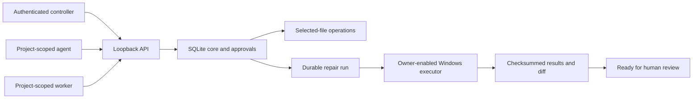
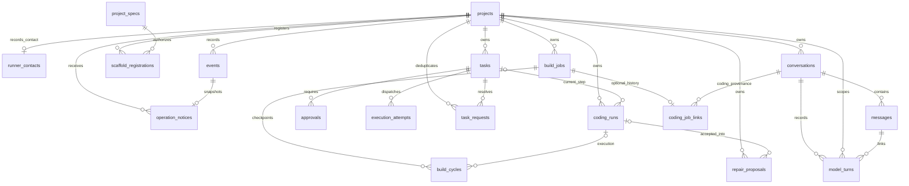
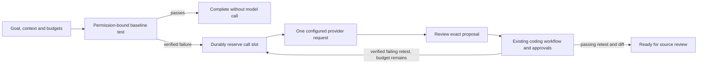

# Jarvis — Architecture

Last maintained: 2026-10-19. This is the canonical current architecture and database record. Update it in place when implementation changes; keep historical detail in Git.

## Product and component boundaries

Jarvis is an internal Windows coordinator with future mobile control and optional hosted operation. The product monorepo owns desktop, core, agent runtime and coding worker. Shared Google/GitHub/social/messaging/document/media/quality/incident projects remain reusable independent repositories. [Repository catalogue](../../REPOSITORIES.md).

| Component | Current state | Responsibility |
|---|---|---|
| `services/core/src/jarvis_core` | Implemented | SQLite state, actor/project policy, approvals, tasks, local API and durable coding runs. |
| `services/runner/run.pyw` | Bounded runner implemented | Hidden per-user worker advances accepted coding runs and bounded model/test repair jobs with durable claims/budgets; source delivery stays separate. |
| `workers/coding/src/skyra_coding` | Implemented | Selected-file snapshots, guarded edits, verification, native execution and controller-supplied repair workflow. |
| `apps/desktop` | Native control slice implemented | Tauri/Rust bridge and tray; React/TypeScript/React Flow subsystem canvas, permissions, proposals, approvals, runs/evidence and stored conversation history. Dedicated Jarvis design. Installer and full agent workspace remain pending. |
| `packages/agent-runtime` | Bounded repair runtime implemented | Explicit Gemini/Groq generation, selected-file context, trusted versioned skills and controller-reviewed patch proposals. Durable chat/draft planning also implemented; general tool selection remains pending; bounded build/test/debug orchestration is implemented. |
| Legacy `main.py`, `core`, `services`, `tools`, `integrations`, `static` | Existing prototype | Original assistant, voice, Telegram, model adapters, memory and UI. It is not connected to the new core policy/worker architecture. |

The existing prototype stays at its launch/import paths until a tested packaging/data migration. Do not move user memory, virtual environments or static assets solely to match a proposed tree.

## Implemented control flow



Controller config determines identities and grants; request payloads cannot select their own actor. Controller creates repair plans and decides approvals. Agents cannot approve, expand scope, claim or self-complete work. Workers cannot change policy or reconcile uncertain effects. Credentials are independent random bearer tokens; server config stores SHA-256 digests. Rotation currently requires a registry change plus restart. Employee/team roles remain pending.

## Technology and runtime

Current implementation: Python standard-library SQLite; FastAPI/Pydantic/Uvicorn local transport; Windows Job Objects for native process supervision. Direct API pins are in [requirements-api.txt](../services/core/requirements-api.txt). These are not a full transitive lock. Implemented desktop stack: Tauri 2, React, TypeScript, Vite and React Flow. Online models come first; future local providers must keep the same authorization boundary.

Local API binds `127.0.0.1:8010`, rejects browser Origin/fetch callers, untrusted Host headers and non-loopback clients, and ignores proxy identity headers. All endpoints require header authentication. Bodies are bounded JSON with a read deadline; errors use sanitized codes and server request IDs. The fixed native desktop bridge owns privileged calls. Mobile access requires a separate secure transport; do not expose this port publicly.

## Database architecture and data ownership

Core owns projects, conversations, messages, policy versions, tasks, approval state, events and coding runs. Filesystem state owns snapshot files/baselines and checksum-addressed reports. Credential registry and OS credential storage are separate concerns. Legacy Qdrant/JSON conversation storage has not been migrated into this core.

SQLite uses foreign keys, WAL, `synchronous=FULL`, a five-second busy timeout and `BEGIN IMMEDIATE` for state transitions. Production local state defaults to `%LOCALAPPDATA%/Skyra/Jarvis/core.sqlite3`, outside the synced repository. No shared/network SQLite file. Hosted PostgreSQL is a future tested migration, not a current dependency.



### Implemented SQLite schema — version 15

Derived from the current Core migrations and SQLite PRAGMA metadata. This is the implemented schema; no proposed entities or invented CHECK constraints are included.

#### `approvals`

| Column | SQLite type | Declared constraint |
|---|---|---|
| `id` | `TEXT` | primary-key position 1 |
| `task` | `TEXT` | NOT NULL |
| `version` | `INTEGER` | NOT NULL |
| `digest` | `TEXT` | NOT NULL |
| `expires` | `REAL` | NOT NULL |
| `state` | `TEXT` | NOT NULL |

Foreign keys: `task` → `tasks.id`.

```sql
CREATE INDEX approvals_task ON approvals(task,version);
```

SQLite-enforced unique key: `id`.

#### `assignment_attempts`

| Column | SQLite type | Declared constraint |
|---|---|---|
| `token` | `TEXT` | primary-key position 1 |
| `assignment` | `TEXT` | NOT NULL |
| `started` | `REAL` | NOT NULL |
| `finished` | `REAL` | No explicit NOT NULL/default constraint |
| `position_before` | `INTEGER` | NOT NULL |
| `position_after` | `INTEGER` | No explicit NOT NULL/default constraint |
| `outcome` | `TEXT` | NOT NULL |

Foreign keys: `assignment` → `assignments.id`.

SQLite-enforced unique key: `token`.

#### `assignments`

| Column | SQLite type | Declared constraint |
|---|---|---|
| `id` | `TEXT` | primary-key position 1 |
| `project` | `TEXT` | NOT NULL |
| `run` | `TEXT` | NOT NULL |
| `request_id` | `TEXT` | NOT NULL |
| `digest` | `TEXT` | NOT NULL |
| `goal` | `TEXT` | NOT NULL |
| `state` | `TEXT` | NOT NULL |
| `max_steps` | `INTEGER` | NOT NULL |
| `steps` | `INTEGER` | NOT NULL |
| `deadline` | `REAL` | NOT NULL |
| `next_due` | `REAL` | NOT NULL |
| `lease_token` | `TEXT` | No explicit NOT NULL/default constraint |
| `lease_until` | `REAL` | No explicit NOT NULL/default constraint |
| `control` | `TEXT` | No explicit NOT NULL/default constraint |
| `summary` | `TEXT` | NOT NULL |
| `created` | `REAL` | NOT NULL |
| `updated` | `REAL` | NOT NULL |

Foreign keys: `run` → `coding_runs.id`, `project` → `projects.id`.

```sql
CREATE INDEX assignment_due ON assignments(project,state,next_due);
```

```sql
CREATE UNIQUE INDEX assignment_active_run ON assignments(run) WHERE state NOT IN ('completed','failed','cancelled');
```

SQLite-enforced unique key: `project`, `request_id`.

SQLite-enforced unique key: `id`.

#### `build_attempts`

| Column | SQLite type | Declared constraint |
|---|---|---|
| `token` | `TEXT` | primary-key position 1 |
| `job` | `TEXT` | NOT NULL |
| `phase` | `TEXT` | NOT NULL |
| `started` | `REAL` | NOT NULL |
| `finished` | `REAL` | No explicit NOT NULL/default constraint |
| `outcome` | `TEXT` | NOT NULL |

Foreign keys: `job` → `build_jobs.id`.

SQLite-enforced unique key: `token`.

#### `build_cycles`

| Column | SQLite type | Declared constraint |
|---|---|---|
| `job` | `TEXT` | primary-key position 1; NOT NULL |
| `cycle` | `INTEGER` | primary-key position 2; NOT NULL |
| `baseline_task` | `TEXT` | No explicit NOT NULL/default constraint |
| `proposal` | `TEXT` | No explicit NOT NULL/default constraint |
| `run` | `TEXT` | No explicit NOT NULL/default constraint |
| `diagnostics` | `TEXT` | No explicit NOT NULL/default constraint |
| `state` | `TEXT` | NOT NULL |

Foreign keys: `run` → `coding_runs.id`, `proposal` → `repair_proposals.id`, `baseline_task` → `tasks.id`, `job` → `build_jobs.id`.

SQLite-enforced unique key: `job`, `cycle`.

#### `build_jobs`

| Column | SQLite type | Declared constraint |
|---|---|---|
| `id` | `TEXT` | primary-key position 1 |
| `project` | `TEXT` | NOT NULL |
| `request_id` | `TEXT` | NOT NULL |
| `digest` | `TEXT` | NOT NULL |
| `config` | `TEXT` | NOT NULL |
| `goal` | `TEXT` | NOT NULL |
| `state` | `TEXT` | NOT NULL |
| `phase` | `TEXT` | NOT NULL |
| `cycle` | `INTEGER` | NOT NULL |
| `calls` | `INTEGER` | NOT NULL |
| `steps` | `INTEGER` | NOT NULL |
| `deadline` | `REAL` | NOT NULL |
| `next_due` | `REAL` | NOT NULL |
| `proposal` | `TEXT` | No explicit NOT NULL/default constraint |
| `run` | `TEXT` | No explicit NOT NULL/default constraint |
| `baseline_task` | `TEXT` | No explicit NOT NULL/default constraint |
| `lease_token` | `TEXT` | No explicit NOT NULL/default constraint |
| `lease_until` | `REAL` | No explicit NOT NULL/default constraint |
| `control` | `TEXT` | No explicit NOT NULL/default constraint |
| `summary` | `TEXT` | NOT NULL |
| `created` | `REAL` | NOT NULL |
| `updated` | `REAL` | NOT NULL |

Foreign keys: `baseline_task` → `tasks.id`, `run` → `coding_runs.id`, `proposal` → `repair_proposals.id`, `project` → `projects.id`.

```sql
CREATE UNIQUE INDEX build_resource_active ON build_jobs(project,json_extract(config,'$.resource')) WHERE state NOT IN ('completed','failed','cancelled');
```

```sql
CREATE INDEX build_job_due ON build_jobs(project,state,next_due);
```

SQLite-enforced unique key: `project`, `request_id`.

SQLite-enforced unique key: `id`.

#### `coding_job_links`

| Column | SQLite type | Declared constraint |
|---|---|---|
| `job` | `TEXT` | primary-key position 1 |
| `conversation` | `TEXT` | NOT NULL |

Foreign keys: `conversation` → `conversations.id`, `job` → `build_jobs.id`.

```sql
CREATE INDEX coding_job_conversation ON coding_job_links(conversation);
```

SQLite-enforced unique key: `job`.

#### `coding_runs`

| Column | SQLite type | Declared constraint |
|---|---|---|
| `id` | `TEXT` | primary-key position 1 |
| `project` | `TEXT` | NOT NULL |
| `resource` | `TEXT` | NOT NULL |
| `plan` | `TEXT` | NOT NULL |
| `owner` | `TEXT` | NOT NULL |
| `state` | `TEXT` | NOT NULL |
| `position` | `INTEGER` | NOT NULL |
| `task` | `TEXT` | No explicit NOT NULL/default constraint |
| `results` | `TEXT` | NOT NULL |
| `request_id` | `TEXT` | No explicit NOT NULL/default constraint |

Foreign keys: `task` → `tasks.id`, `project` → `projects.id`.

```sql
CREATE UNIQUE INDEX coding_run_request ON coding_runs(project,request_id);
```

```sql
CREATE UNIQUE INDEX coding_resource_active ON coding_runs(project,resource) WHERE state NOT IN ('failed','ready_for_review','cancelled');
```

SQLite-enforced unique key: `id`.

#### `conversations`

| Column | SQLite type | Declared constraint |
|---|---|---|
| `id` | `TEXT` | primary-key position 1 |
| `project` | `TEXT` | NOT NULL |

Foreign keys: `project` → `projects.id`.

SQLite-enforced unique key: `id`.

#### `events`

| Column | SQLite type | Declared constraint |
|---|---|---|
| `id` | `INTEGER` | primary-key position 1 |
| `project` | `TEXT` | NOT NULL |
| `kind` | `TEXT` | NOT NULL |
| `subject` | `TEXT` | NOT NULL |
| `at` | `REAL` | NOT NULL |

Foreign keys: `project` → `projects.id`.

```sql
CREATE INDEX events_project_cursor ON events(project,id);
```

#### `execution_attempts`

| Column | SQLite type | Declared constraint |
|---|---|---|
| `task` | `TEXT` | primary-key position 1; NOT NULL |
| `token` | `TEXT` | primary-key position 2; NOT NULL |

Foreign keys: `task` → `tasks.id`.

SQLite-enforced unique key: `task`, `token`.

#### `messages`

| Column | SQLite type | Declared constraint |
|---|---|---|
| `id` | `INTEGER` | primary-key position 1 |
| `conversation` | `TEXT` | NOT NULL |
| `role` | `TEXT` | NOT NULL |
| `content` | `TEXT` | NOT NULL |
| `request_id` | `TEXT` | NOT NULL |

Foreign keys: `conversation` → `conversations.id`.

SQLite-enforced unique key: `conversation`, `request_id`.

#### `model_turns`

| Column | SQLite type | Declared constraint |
|---|---|---|
| `id` | `TEXT` | primary-key position 1 |
| `conversation` | `TEXT` | NOT NULL |
| `project` | `TEXT` | NOT NULL |
| `request_id` | `TEXT` | NOT NULL |
| `digest` | `TEXT` | NOT NULL |
| `provider` | `TEXT` | NOT NULL |
| `model` | `TEXT` | NOT NULL |
| `mode` | `TEXT` | NOT NULL |
| `state` | `TEXT` | NOT NULL |
| `context` | `TEXT` | NOT NULL |
| `response` | `TEXT` | No explicit NOT NULL/default constraint |
| `usage` | `TEXT` | No explicit NOT NULL/default constraint |
| `error` | `TEXT` | No explicit NOT NULL/default constraint |
| `user_message` | `INTEGER` | NOT NULL |
| `assistant_message` | `INTEGER` | No explicit NOT NULL/default constraint |
| `created` | `REAL` | NOT NULL |

Foreign keys: `assistant_message` → `messages.id`, `user_message` → `messages.id`, `project` → `projects.id`, `conversation` → `conversations.id`.

```sql
CREATE UNIQUE INDEX conversation_model_active ON model_turns(conversation) WHERE state IN ('planned','generating');
```

SQLite-enforced unique key: `conversation`, `request_id`.

SQLite-enforced unique key: `id`.

#### `operation_notices`

| Column | SQLite type | Declared constraint |
|---|---|---|
| `id` | `TEXT` | primary-key position 1 |
| `project` | `TEXT` | NOT NULL |
| `event` | `INTEGER` | NOT NULL |
| `subject` | `TEXT` | NOT NULL |
| `fingerprint` | `TEXT` | NOT NULL |
| `payload` | `TEXT` | NOT NULL |
| `created` | `REAL` | NOT NULL |
| `acknowledged` | `REAL` | No explicit NOT NULL/default constraint |

Foreign keys: `event` → `events.id`, `project` → `projects.id`.

```sql
CREATE INDEX operation_subject ON operation_notices(project,subject,event DESC);
```

```sql
CREATE INDEX operation_inbox ON operation_notices(project,event DESC);
```

SQLite-enforced unique key: `event`.

SQLite-enforced unique key: `id`.

#### `project_specs`

| Column | SQLite type | Declared constraint |
|---|---|---|
| `id` | `TEXT` | primary-key position 1 |
| `project` | `TEXT` | NOT NULL |
| `version` | `INTEGER` | NOT NULL |
| `source_turn` | `TEXT` | NOT NULL |
| `request_id` | `TEXT` | NOT NULL |
| `digest` | `TEXT` | NOT NULL |
| `sha256` | `TEXT` | NOT NULL |
| `documents` | `TEXT` | NOT NULL |
| `state` | `TEXT` | NOT NULL |
| `created` | `REAL` | NOT NULL |
| `approved` | `REAL` | No explicit NOT NULL/default constraint |
| `parent_spec` | `TEXT` | No explicit NOT NULL/default constraint |

Foreign keys: `parent_spec` → `project_specs.id`, `source_turn` → `model_turns.id`, `project` → `projects.id`.

SQLite-enforced unique key: `project`, `request_id`.

SQLite-enforced unique key: `project`, `version`.

SQLite-enforced unique key: `id`.

#### `projects`

| Column | SQLite type | Declared constraint |
|---|---|---|
| `id` | `TEXT` | primary-key position 1 |
| `owner` | `TEXT` | NOT NULL |
| `name` | `TEXT` | NOT NULL |
| `mode` | `TEXT` | NOT NULL |
| `version` | `INTEGER` | NOT NULL |
| `resources` | `TEXT` | NOT NULL |

SQLite-enforced unique key: `id`.

#### `repair_proposals`

| Column | SQLite type | Declared constraint |
|---|---|---|
| `id` | `TEXT` | primary-key position 1 |
| `project` | `TEXT` | NOT NULL |
| `request_id` | `TEXT` | NOT NULL |
| `digest` | `TEXT` | NOT NULL |
| `resource` | `TEXT` | NOT NULL |
| `profile` | `TEXT` | NOT NULL |
| `provider` | `TEXT` | NOT NULL |
| `model` | `TEXT` | NOT NULL |
| `state` | `TEXT` | NOT NULL |
| `context` | `TEXT` | NOT NULL |
| `response` | `TEXT` | No explicit NOT NULL/default constraint |
| `usage` | `TEXT` | No explicit NOT NULL/default constraint |
| `error` | `TEXT` | No explicit NOT NULL/default constraint |
| `run` | `TEXT` | No explicit NOT NULL/default constraint |
| `created` | `REAL` | NOT NULL |

Foreign keys: `run` → `coding_runs.id`, `project` → `projects.id`.

SQLite-enforced unique key: `project`, `request_id`.

SQLite-enforced unique key: `id`.

#### `runner_contacts`

| Column | SQLite type | Declared constraint |
|---|---|---|
| `project` | `TEXT` | primary-key position 1 |
| `attempt` | `TEXT` | NOT NULL |
| `started` | `REAL` | NOT NULL |
| `finished` | `REAL` | No explicit NOT NULL/default constraint |
| `outcome` | `TEXT` | NOT NULL |

Foreign keys: `project` → `projects.id`.

SQLite-enforced unique key: `project`.

#### `scaffold_registrations`

| Column | SQLite type | Declared constraint |
|---|---|---|
| `id` | `TEXT` | primary-key position 1 |
| `project` | `TEXT` | NOT NULL |
| `specification` | `TEXT` | NOT NULL |
| `name` | `TEXT` | NOT NULL |
| `directory` | `TEXT` | NOT NULL |
| `plan_sha256` | `TEXT` | NOT NULL |
| `config_sha256` | `TEXT` | NOT NULL |
| `config` | `TEXT` | NOT NULL |
| `created` | `REAL` | NOT NULL |

Foreign keys: `specification` → `project_specs.id`, `project` → `projects.id`.

SQLite-enforced unique key: `project`, `name`.

SQLite-enforced unique key: `directory`.

SQLite-enforced unique key: `id`.

#### `task_requests`

| Column | SQLite type | Declared constraint |
|---|---|---|
| `project` | `TEXT` | primary-key position 1; NOT NULL |
| `request_id` | `TEXT` | primary-key position 2; NOT NULL |
| `digest` | `TEXT` | NOT NULL |
| `task` | `TEXT` | NOT NULL |

Foreign keys: `task` → `tasks.id`, `project` → `projects.id`.

SQLite-enforced unique key: `project`, `request_id`.

#### `tasks`

| Column | SQLite type | Declared constraint |
|---|---|---|
| `id` | `TEXT` | primary-key position 1 |
| `project` | `TEXT` | NOT NULL |
| `action` | `TEXT` | NOT NULL |
| `resource` | `TEXT` | NOT NULL |
| `payload` | `TEXT` | NOT NULL |
| `digest` | `TEXT` | NOT NULL |
| `state` | `TEXT` | NOT NULL |
| `lease_token` | `TEXT` | No explicit NOT NULL/default constraint |
| `lease_until` | `REAL` | No explicit NOT NULL/default constraint |
| `policy_version` | `INTEGER` | No explicit NOT NULL/default constraint |
| `evidence` | `TEXT` | No explicit NOT NULL/default constraint |

Foreign keys: `project` → `projects.id`.

```sql
CREATE INDEX tasks_recovery ON tasks(project,state,lease_until);
```

SQLite-enforced unique key: `id`.

### Storage semantics and constraints

- `projects.resources`, task payload/evidence and coding-run plan/results are JSON encoded in TEXT. Validation belongs to the current application; future migrations may normalize fields where useful.
- Project policy defaults to read-only with no resources. Full mode is bounded by exact logical resource IDs, not global administrator access.
- Task intent hashes bind actor, project, action, resource and canonical payload. Approval binds that digest, policy version and expiry; consumption is single-use. A changed policy invalidates an earlier decision.
- Message deduplication is per conversation/request ID; task and run deduplication are per project/request ID. Reusing a key with different input conflicts.
- `execution_attempts` prevents dispatching the same lease twice. `coding_resource_active` prevents concurrent active repair runs on the same project/resource.
- Events have monotonically increasing SQLite IDs and replay cursors; they reference subjects rather than duplicating message content. This is not yet a complete multi-user audit schema with separate approver identity fields.
- Long execution uses bounded leases and periodic heartbeats, not a held SQLite transaction. File effects cannot roll back with database state. Unknown effects become interrupted and need explicit reconciliation.
- Native/container test outputs and diffs are referenced by SHA-256; evidence lookup checks ownership, attachment and checksum. Private filesystem access controls remain necessary. Runtime artifacts are ignored by Git.

### Proposed future entities — not implemented

| Entity | Intended fields/relationship |
|---|---|
| MemoryRevision | project/actor scope, teaching, source/provenance, revision, superseded_by, retention; search entries reference revisions. |
| Artifact | project/run/task ID, location reference, checksum, format, verification status and retention. Current artifacts are filesystem reports with task evidence references. |
| SkillInstallation | version, source checksum, capabilities, required grants and evaluation status. |
| Schedule | timezone, due time, job template, policy version, deduplication/lease state. |
| DevicePairing | actor/device, revocable credentials, grants, expiry and last connection. |

Do not mark these built or invent deployed tables. Define migration and retention/export rules before implementation. No live customer/employee data belongs in examples.

## Worker and execution boundaries

The trusted host registers `(project, resource)` to a selected-file snapshot. Snapshot limits are 100 UTF-8 text files, 1 MiB each, 10 MiB total. Unselected files, traversal, known secrets, hard links, symlinks/reparse points and alternate data streams are rejected. Patches require a current content hash and exactly one anchor. Baseline and evidence sit outside editable files. Source repository, Git index and user changes are not modified by delivery.

Native mode requires explicit owner enablement and fixed profiles for trusted projects. It carries the Windows account's file/network access and is not a security sandbox. A reduced inherited environment limits accidental token propagation but cannot prevent code from reading accessible host files. Suspended process launch ensures Job Object assignment before project code starts; timeout, ordinary child cleanup and output bounds are verified. Service-launched unrelated processes and hostile same-account code are outside that supervision guarantee.

Optional Docker adapter requires reviewed digest-pinned images, no automatic pulls, no network, read-only selected-file mount, dropped capabilities, non-root user and resource limits. Only configuration contracts are tested here; no live Docker engine exists on this PC. There is no silent backend fallback.

## Durable repair workflow

Controller supplies an immutable repair plan. Sequence: failing baseline test → explicit patches → passing retest through the same protected profile → diff. Ask-mode pauses are persisted. Plans cannot edit protected tests. Runtime/cleanup failures do not count as a reproduced test failure. Only matching task-bound execution evidence can satisfy the final gate. Completion is `ready_for_review`, never automatic push/deploy or universal production readiness.

Plans may now originate from a validated Gemini/Groq proposal that the controller accepts. Worker advance handles one step; an always-on scheduler is not implemented. Restart checkpoints between completed steps and duplicate request/dispatch handling are verified. Active effects after a machine crash require reconciliation.

## Launch, recovery and operations

### Configuration ownership

Authentication registry is a private JSON array of entries with `token_sha256` (64 lowercase hex characters), `actor`, `role` (`controller`, `agent`, `worker`) and `projects` (explicit IDs for agent/worker). Raw bearer tokens are independently generated, for example using `secrets.token_urlsafe(32)`, and belong in protected client storage. The model never receives controller credentials. No permanent credentials were generated by the implementation tests.

Trusted workspace configuration has this structure; substitute real absolute paths, project IDs and an already-installed executable:

```json
{
  "evidence_root": "C:/private/jarvis/evidence",
  "workspaces": [
    {"project_id": "<project-id>", "resource_id": "workspace:run-1", "directory": "C:/private/jarvis/snapshot"}
  ],
  "execution": {
    "mode": "native_trusted",
    "owner_enabled": true,
    "profiles": [
      {
        "name": "python-unit",
        "argv": ["C:/path/to/python.exe", "-B", "-m", "unittest", "discover", "-s", "tests", "-v"],
        "protected_paths": ["tests/test_app.py"],
        "timeout": 120
      }
    ]
  }
}
```

Profiles are owner configuration, not model arguments. Without an execution section the worker supports files/static checks only. Docker mode uses `mode: docker`, a fixed `context` and profiles with `name`, digest-pinned `image`, fixed `argv`, `protected_paths` and `timeout`; it never silently falls back to native mode. Protect config writes using OS account permissions. Native mode is an explicit trust choice, not implied by full project policy.

Developer launch: `venv/Scripts/python.exe services/core/run.py --auth-config <private registry> --workspace-config <trusted workspace registry>`. The workspace registry selects explicit native or Docker profiles; no registration endpoint grants arbitrary directories to model input. Protect registry writes as authorization decisions. The hidden desktop supervisor is implemented; a signed bundled installer remains pending.

Test with the core and worker suites listed in [development](DEVELOPMENT.md). The repeatable `workers/coding/repair_demo.py --directory <new directory>` uses generated trusted fixtures, no model calls and no Git writes. The demo's repair bundle is ignored runtime data, not a new permanent Markdown report.

Backup/restore, data export/deletion, migrations to hosted storage, credential-store integration and operational telemetry remain release gates. API security and file checks do not make the legacy direct-shell tools safe or governed by this architecture.

## Coding-engine performance direction — planned

Public patterns from [Claude Code](https://code.claude.com/docs/en/how-claude-code-works), [Codex App Server](https://learn.chatgpt.com/docs/app-server), [OpenCode](https://opencode.ai/docs/server/), [Antigravity](https://antigravity.google/docs/artifacts) and [Cursor's historical edit research](https://cursor.com/blog/instant-apply) inform the design; they do not establish private internals or a superiority claim. Keep the engine independent of clients, retrieve targeted context, load skills/tools progressively, preserve warm connections, apply hash-checked edits and parallelize only independent work. Optional code intelligence must be benchmarked; indexes can become stale.

Use fast/balanced/thorough effort profiles without bypassing permissions or required verification. Small edits should not always pay for planner/critic/reviewer model calls. Measure first useful response, first valid edit, end-to-end verified completion, cost per accepted task, regressions, retries and human intervention. Use at least 30 representative tasks plus a held-out set, identical starting snapshots, recorded model/tool/effort/cache settings and independent acceptance. A provisional 20% median speed improvement target is a goal, not a measured claim. Required correctness and policy-failure rates cannot regress to make a speed number look better.

## Architecture decisions and implementation changes

| Date | Decision/change | Current result |
|---|---|---|
| 2026-10-14 | Jarvis monorepo; independent reusable service repositories | Desktop/runtime/coding specifications live in Jarvis; foundation lives with contracts. |
| 2026-10-14 | Local durable core and authenticated roles | Implemented; current SQLite schema 5 includes request and execution ownership. |
| 2026-10-14 | Selected snapshots and approved file operations | Implemented; original source and Git state preserved. |
| 2026-10-14 | Owner selected trusted native execution first | Real Windows repair workflow verified; native access is explicitly labelled. |
| 2026-10-14 | Optional isolated execution | Docker adapter prepared; live isolation verification remains pending. |
| 2026-10-14 | Consolidated maintained documentation | Architecture/database/decisions here; functionality and development maintained alongside it. No per-change Markdown reports. |

## Initial specification set

Retain and update the original nine documents. They describe product requirements, system architecture, development rules, design, tasks, memory, API/events, testing/acceptance and security/operations. These current overview files supplement them; they do not replace them.

- [Product requirements](01_PRODUCT_REQUIREMENTS.md)
- [System architecture](02_SYSTEM_ARCHITECTURE.md)
- [Development rules](03_DEVELOPMENT_RULES.md)
- [Design system](04_DESIGN_SYSTEM.md)
- [Project tasks](05_PROJECT_TASKS.md)
- [Project memory](06_PROJECT_MEMORY.md)
- [API and event contracts](07_API_AND_EVENTS.md)
- [Testing and acceptance](08_TESTING_AND_ACCEPTANCE.md)
- [Security and operations](09_SECURITY_AND_OPERATIONS.md)

## Model proposal runtime and database migration 6

Source: `packages/agent-runtime/src/jarvis_runtime`; optional direct SDK pins: `packages/agent-runtime/requirements.txt`. Core remains the owner of all durable orchestration state. No LangGraph dependency is required for this bounded state machine.

`repair_proposals` columns: `id TEXT PRIMARY KEY`, `project TEXT NOT NULL REFERENCES projects(id)`, `request_id TEXT NOT NULL`, `digest TEXT NOT NULL`, `resource TEXT NOT NULL`, `profile TEXT NOT NULL`, `provider TEXT NOT NULL`, `model TEXT NOT NULL`, `state TEXT NOT NULL`, `context TEXT NOT NULL`, nullable `response TEXT`, `usage TEXT`, `error TEXT`, `run TEXT REFERENCES coding_runs(id)`, and `created REAL NOT NULL`; unique `(project,request_id)`. Existing version-5 projects/conversations/tasks/runs are preserved by migration. JSON fields are application-validated TEXT; no additional CHECK constraints are claimed.

States: planned → generating → ready → accepted; generation failure → failed; controller interruption from planned/generating/ready → interrupted. A generating request is never automatically resent after restart. The controller can interrupt an uncertain generation and explicitly create a new request ID. Interruption does not cancel a provider-side request or reverse its cost; late responses cannot revive it. Acceptance and run creation share one SQLite transaction. Provider calls hold no database transaction. The existing worker still advances each run step explicitly.

Context is explicitly selected (1–20 files, ≤96 KB serialized UTF-8 including goal/skills/schema). It stores goal, source text/hashes, protected flags, trusted skill name/version/instructions/checksum, response schema and test-profile checksum. Review rechecks current file hashes, resource grants and test profile. Output is bounded (≤64 KB), strict local JSON with one unique anchor replacement per file and 1–10 patches. Paths must be in context; protected tests, stale hashes, duplicate paths, unknown fields and ineffective edits are rejected. Request idempotency binds caller intent, preserving the first context on repeated creation.

Gemini uses structured JSON output; Groq uses JSON object mode plus the same local semantic validation. Both use official SDKs, fixed configured models, bounded timeout/output tokens and one attempt. They receive no tools, controller credentials, workspace paths or execution keys. Provider errors are sanitized into fixed codes, optionally an allowlisted HTTP status. Safe usage counts remain recorded even when patch validation fails; unknown usage remains null. These are token counts, not currency billing records. Raw exceptions, invalid model responses and private reasoning are not stored.

Trusted startup adds `--runtime-config <private-json-path>` alongside `--workspace-config`. The shape is in [config.example.json](../packages/agent-runtime/config.example.json). Provider entries contain environment variable names, never key values; startup does not implicitly load repository `.env` or rotate/fallback keys. Existing legacy `.env` can be used explicitly by the generated-fixture demo only. SDKs are optional when the runtime is disabled. Private SQLite contains selected source and goals: use local app-data access controls, backups and retention policy. Secret filename filtering cannot detect arbitrary secrets embedded in otherwise allowed source; the controller must review selections before generation. This milestone adds no new encryption or remote data-retention guarantee.

The first skill is trusted `minimal-repair` guidance configured by the host. Skills have no executable hooks and cannot grant permissions. Skill auto-discovery, teaching storage, search embeddings, full planning/delegation, cost ceilings, broad project creation and always-on scheduling are future work.

Official adapter references: [Gemini generation API](https://ai.google.dev/api/generate-content), [Groq JSON/structured output](https://console.groq.com/docs/structured-outputs), [Groq SDK retry settings](https://github.com/groq/groq-python#retries).

## Windows control centre — implemented slice

`apps/desktop` owns a Tauri 2 Rust host and React/TypeScript/Vite/React Flow interface, with no Skyra Platform UI dependency. Exact JS dependencies are locked in `pnpm-lock.yaml`; Rust dependencies in `src-tauri/Cargo.lock`, with Rust 1.99.0 pinned. Current direct stack: React 19.3.1, React Flow 12.12.0, Vite 8.3.4, TypeScript 7.0.2, Tauri API/crate 2.12.3 and CLI 2.12.2. React state is sufficient for this bounded slice; the proposed TanStack Query/Zustand adoption is deferred until their caching/layout responsibilities are needed.

Renderer → allowlisted Tauri `core_request` → native fixed-loopback HTTP client → existing core policy/workflow. The renderer supplies an operation and validated IDs, never a URL, bearer token or shell command. Native host owns a controller credential and an optional separate project-scoped worker credential; only run advancement uses the worker token. Unknown actions/fields, non-UUID IDs and invalid artifact checksums are rejected. Proxies, redirects and retries are disabled; requests/responses/timeouts are bounded (128 KiB request, 2 MiB response, 125 seconds overall). The renderer cannot call the core directly; browser Origin restrictions are unchanged. Browser `?preview=1` is explicitly fixture-only and cannot contact the core; it is disabled inside Tauri.

Trusted desktop configuration defaults to `%LOCALAPPDATA%/Skyra/Jarvis/desktop.json` (or host-set `JARVIS_DESKTOP_CONFIG`), with `port`, `controller_token_dpapi` and optional `worker_token_dpapi`. Token ciphertext is user-bound Windows DPAPI, not renderer storage. `bootstrap.py` initializes a new private state directory, hashed core auth registry and launcher config; it refuses existing state and enables no worker, native execution or provider by default. Paths/test commands/model keys still require trusted host configuration. DPAPI does not isolate hostile code running as the same Windows user.

`launch.pyw` uses an authenticated local health check, rejects redirects and starts an owned Python core with CREATE_NO_WINDOW only when needed. It opens the GUI release executable and stops only that owned core when the application exits. Closing the window hides to the tray; the tray has Open and Exit. A second launch restores the existing window. Release binaries use the Windows GUI subsystem. No automatic startup at login, crash supervisor, signed installer/updater or bundled Python backend is claimed. Tray Exit can interrupt active effects; recovery/reconciliation remains explicit through the core.

`GET /v1/projects/{project}/dashboard` is controller-only and derives bounded current state: project policy, conversation counts, recent proposals/runs, pending approvals with server-derived validity, permitted workspace filenames, registered logical resource IDs, worker/runtime capabilities and recent events. It includes no leases, raw tokens, message bodies, proposal source or task payloads. The UI fetches exact details separately. The first desktop control slice added no database tables. The subsequent conversation/planning slice advances SQLite to version 7 as described below. Policy updates optionally accept `expected_version`; the UI always supplies the reviewed version to prevent lost updates. Saving a policy increments its version and invalidates earlier approvals.

The UI polls the current project every ten seconds while visible/idle; it does not advance workflows automatically. Long-request cancellation/interruption has an independent control request lane, so it remains available while advance/generation is pending. Recent lists are bounded at 100 items, events at 50; message reads use ten-message cursor pages. Native model/API results remain plain text/structured JSON; no model-supplied HTML is executed. Optional subsystem nodes are marked planned/unavailable until actually integrated. Canvas is a capability/connection map, not an executable workflow authoring engine.

Upstream implementation references: [Tauri native commands](https://v2.tauri.app/develop/calling-rust/), [capabilities](https://v2.tauri.app/security/capabilities/), [system tray](https://v2.tauri.app/learn/system-tray/), [single instance](https://v2.tauri.app/plugin/single-instance/), [React Flow](https://reactflow.dev/learn).

## Conversation and draft planning architecture

### `model_turns` — migration 7

| Column | SQLite type | Constraint / meaning |
|---|---|---|
| `id` | `TEXT` | primary key |
| `conversation` | `TEXT` | NOT NULL; conversations.id |
| `project` | `TEXT` | NOT NULL; projects.id |
| `request_id` | `TEXT` | NOT NULL |
| `digest` | `TEXT` | NOT NULL; intent checksum |
| `provider` | `TEXT` | NOT NULL; registered alias |
| `model` | `TEXT` | NOT NULL; exact model |
| `mode` | `TEXT` | NOT NULL; chat or plan |
| `state` | `TEXT` | NOT NULL |
| `context` | `TEXT` | NOT NULL; JSON snapshot |
| `response` | `TEXT` | nullable; validated JSON |
| `usage` | `TEXT` | nullable; bounded token counts |
| `error` | `TEXT` | nullable; safe code only |
| `user_message` | `INTEGER` | NOT NULL; messages.id |
| `assistant_message` | `INTEGER` | nullable; messages.id |
| `created` | `REAL` | NOT NULL; timestamp |

Unique `(conversation, request_id)` binds retry identity to a SHA-256 intent digest. The partial unique index `conversation_model_active` on conversation applies while state is planned or generating. States are planned → generating → completed/failed, or planned/generating → interrupted. Other terminal states are never redispatched. Generating state after a crash means uncertain; the owner must inspect/interrupt it, not retry the paid call.

Creation atomically snapshots the recent contiguous history suffix, current request, explicit response schema and trusted instruction version/hash, inserts the user message, creates the turn and emits events. History is at most 30 complete messages; total encoded context is bounded below 48 KB. Oversized current requests fail before persistence. Older messages remain in SQLite and the UI shows the omitted count. No project files, workspace paths, keys or tool outputs are automatically added.

Generation atomically claims planned state, releases the transaction before the network call and makes one provider attempt. The same registered alias, provider family, model, response schema and instruction hash must still match. Gemini receives the schema through its SDK and context; Groq JSON mode receives the schema explicitly in context. Strict local validation rejects duplicate keys, nonfinite JSON, extra fields, executable-shaped fields and incomplete plans. Successful response, usage, assistant message and completion event commit together. Failure stores only a safe code; interruption prevents late output from appending a response. This does not promise to cancel provider billing.

Core provides owner-scoped history and interruption even without provider configuration. Provider setup no longer requires FileWorker: chat-only configurations can load the same trusted runtime JSON. RepairRuntime is registered only when a worker exists. The native Rust bridge exposes fixed controller routes for setup and model turns; renderer code cannot supply transport URLs or credentials.

The setup checklist is read-only configuration guidance. Paths/commands, worker identity, environment secrets and native execution consent remain trusted configuration. Configuration editing, streaming, learned-memory governance, document/file delivery and an approved plan-to-build state machine remain pending.

## Flexible desktop workspace

The React Workspace shell owns per-window tabs and calls App with a controlled view. Up to eight tabs are available per window. Visited tabs remain mounted while hidden to preserve draft/selection state; restored tabs mount only when first activated, and inactive tabs pause dashboard polling. The shell keeps window controls visible and scrolls content inside the available viewport. Native windows retain standard OS decorations for resizing, snapping and moving between monitors. Core and map are separate built-in views as well as overview cards. The orbital object is CSS 3D geometry, not an additional model/runtime or WebGL dependency; animation is opt-in and reduced-motion aware.

Native workspace.rs exposes only two custom commands. open_panel validates a fixed view allowlist plus an optional lowercase 32-hex project ID, generates its own label and builds a local app URL. There are at most eight additional windows. workspace_action controls the invoking window (minimize, maximize, fullscreen, logical width/height), shows open windows, or saves/restores a bounded arrangement. Window capabilities cover main and host-created panel-* labels; they do not expose generic webview creation, remote navigation, shell or filesystem plugins. Existing server authorization remains authoritative across every window.

### UI persistence; Core schema remains 7

- WebView localStorage key jarvis.workspace.v1.<window-label> stores version 1, tab IDs, built-in views, project IDs, minimized flags and active ID. It contains no conversation content or credentials. Corrupt records fall back to one usable Overview tab. Metadata restores automatically; in-memory drafts do not survive restart/closing a tab.
- Explicit Save window arrangement writes versioned window-arrangement.json beside the trusted desktop config when JARVIS_DESKTOP_CONFIG is set; otherwise it uses the native application data directory. It contains labels, built-in view/project metadata, physical normal/current dimensions, positions and maximized state. Writes use a temporary file and replacement. Restore reads at most 32 KB, rejects unknown fields/invalid records/duplicates/more than nine windows, validates views and IDs, then fits geometry to current connected monitor work areas and shows windows. Minimized/fullscreen windows must first return to normal mode before saving.
- Restore is explicit. It repositions existing saved windows and recreates missing saved panels; extra currently open panels are preserved. At the window cap, close unused panels before restoring additional ones. Windows keep independent tab metadata; no durable agent work is replayed by restoring a layout.

Closing main continues to hide to tray. Closing a child destroys only that window. Show all windows unminimizes open windows; tray/second-instance activation unminimizes the main window. Explicit Exit remains the application/core lifecycle boundary. A full dockable grid editor, named arrangement profiles, automatic reopening of all external windows and cross-device layout sync remain future work.


## Versioned specifications and repair handoff - 2026-10-15

Migration 8 adds `project_specs`. Its immutable payload is a canonical JSON map of four host-defined Markdown document names to text: requirements, phased tasks, acceptance criteria and planning record. The source is a completed `plan` model turn in the same project. No additional provider call or repository filesystem write occurs. Missing architecture/design/security detail is not fabricated.

| Column | SQLite type | Constraint / meaning |
|---|---|---|
| id | TEXT | PRIMARY KEY |
| project | TEXT | NOT NULL, FK projects(id) |
| version | INTEGER | NOT NULL, UNIQUE(project,version) |
| source_turn | TEXT | NOT NULL, FK model_turns(id) |
| request_id | TEXT | NOT NULL, UNIQUE(project,request_id) |
| digest | TEXT | NOT NULL, publication intent SHA-256 |
| sha256 | TEXT | NOT NULL, canonical document bundle SHA-256 |
| documents | TEXT | NOT NULL, immutable canonical JSON |
| state | TEXT | NOT NULL, application-managed draft/approved/superseded |
| created | REAL | NOT NULL, publication time |
| approved | REAL | nullable approval time |

Publication uses BEGIN IMMEDIATE, owner checks, idempotency lookup, completed-plan verification and expected latest-version comparison. Duplicate request IDs with identical intent return the original snapshot; changed intent conflicts. Approving requires the exact checksum and latest version. The same approval is idempotent; a new approval supersedes the prior approved version atomically. Publishing a draft does not revoke existing approval. Lists return at most 100 metadata records. Full documents are retrieved through a separate owner-checked detail route. No new schema CHECK constraints are claimed.

Repair proposal creation accepts optional `specification`. Its intent digest includes that ID; its immutable context embeds the specification ID/version/checksum/documents under the existing 96 KB total context cap. Only an approved version owned by the same project is eligible. Freshness checks before dispatch, after provider completion and during atomic acceptance reject superseded approval. Already accepted runs retain their original fixed repair steps; explicit run cancellation and existing task approvals govern execution. These are selected-file repairs, not a general greenfield build agent.

The Rust bridge adds four fixed controller actions (specifications, publish_specification, specification, approve_specification). Documents are displayed in expandable preformatted text. No generic filesystem/export command, HTML rendering, new service, framework or dependency is added.


## Specification revisions and approved document delivery - 2026-10-15

Migration 9 appends `parent_spec TEXT REFERENCES project_specs(id)` (nullable). Existing rows and their approval/checksum/history remain intact. Publication names its INSERT columns to remain compatible with the appended column. Revisions preserve original source_turn and point to their immediate parent. They may branch from an older snapshot only while supplying the current latest project version. Core stores a new draft with a new ID, checksum and sequential version; it never mutates source documents. Approval supersession behavior remains unchanged.

Revision input is a map of 4-9 host-allowlisted standard Markdown filenames. Requirements, tasks, memory and acceptance documents are required; architecture/development/design/API/security documents are optional owner-authored additions. Every included document must be nonempty, NUL-free and at most 24,000 UTF-8 bytes; canonical JSON is limited to 64,000 bytes. Revision idempotency hashes operation/parent/checksum/latest version/documents. BEGIN IMMEDIATE, owner checks, request replay lookup, parent checksum and project latest-version CAS protect writes. Unchanged revisions are rejected. The same snapshot lineage, source turn and parent are available through detail reads.

Export preparation is a controller-only Core transaction: require approved state and expected checksum, validate documents and stored-bundle integrity, append specification.export_prepared, then return canonical_documents, ID/project/version/checksum, parent and approval/preparation timestamps. This event means data prepared, not files successfully delivered. Later supersession does not erase already exported files; a delivered bundle records point-in-time provenance and is not an execution grant.

The Rust host exposes only export_specification(id, expected_sha256), fetches export data through the existing authenticated Bridge and independently validates IDs, canonical-byte SHA-256, filenames and bounds. sha2 0.10.9 becomes a direct dependency using the version already present in Cargo.lock; no generic filesystem plugin is enabled. Default root is Documents/Skyra/Jarvis/exports; trusted JARVIS_EXPORT_ROOT may select an absolute root whose parent already exists. Fixture acceptance sets that root inside its generated directory. No renderer path/content is accepted.

Output path: <root>/<32hex-project>/v<version>-<32hex-specification>/. Files contain exact UTF-8 document bytes plus manifest.json with canonical bundle and provenance. A newly created .pending folder receives create_new files and flushed contents, then is renamed to the version folder. Known reparse points within the root are rejected. Existing folders are accepted only when manifest identity/hash/canonical bundle and every literal document byte match, with no extra entries. Export never overwrites files. A failed staging write attempts cleanup of known files and its own staging folder without recursive deletion. Host-controlled-root operations do not claim protection against a malicious process running under the same Windows account or parent-directory replacement races.

Export manifest reads are bounded to 256 KiB, allowing JSON string escaping of a 64,000-byte canonical bundle plus provenance. Repeat export also checks parent/approval identity and rejects a future preparation time; canonical hash and all file bytes remain required. This manifest is local provenance, not a signed attestation.


## Reviewed new-file additions - 2026-10-15

SQLite remains version 9. Filesystem snapshot manifests support version 2 when new targets are selected: files contains existing selected paths plus explicit create_paths; hashes maps existing files to their real baseline hashes and creation targets to the sentinel "absent". Existing version-1 manifests remain readable. Snapshot preparation rejects existing creation targets, Windows-invalid/protected paths, case-fold aliases and file/directory-prefix collisions before destination creation. Source files remain untouched. CLI: `venv/Scripts/python.exe workers/coding/snapshot.py --source <source> --destination <outside-source-snapshot> --files tests/test_feature.py --create feature.py`.

Workspace.read returns sha256="absent", empty content and exists=false only for an explicitly selected missing creation target. A real existing file still returns its real hash. Missing ordinary selected files remain errors. Workspace.create accepts only registered creation targets and nonempty UTF-8 content within 1 MiB, checks the path boundary and uses exclusive binary creation with flush/fsync. It never replaces a file. Creation evidence records before_sha256="absent" and a real resulting content hash. Diff compares new files with /dev/null; absent targets yield no diff and cannot count as static verification success. Search omits their empty content.

The model response schema stays summary/patches. A creation entry uses expected_sha256="absent", old="" and full content in new. Existing-file patches still require exact old-text uniqueness and their real hash. Selection, protected-test and duplicate-path checks apply to both. Runtime freshness checks compare absence before dispatch, after provider response and at acceptance. Optional approved-specification context and supersession checks continue to apply.

CodingWorkflow translates valid creation entries into write tasks with exact payload {operation:"create",path,content}; existing patch entries remain unchanged. It still requires a protected test baseline to fail, then the approved writes, a protected passing retest and final diff evidence. Run-request replay lookup occurs before a new absence check so retries recover the same run after creation. New requests cannot claim an occupied target. Generic new-project scaffolding, model-created protected tests, multi-iteration debugging, changes written back to source and Git delivery remain pending.

Execution copies include only currently present selected files. Both native and optional Docker backends reject absent protected-test baselines before dispatch; an absent target never satisfies test integrity. Execution occurs in a fresh temporary selected-file copy, with the existing fixed profile and cleanup supervisor. Native mode remains trusted Windows account execution, not a process security sandbox.

Creation file effects cannot roll back with the guarded SQLite transaction. An interrupted create/write can leave partial or completed content and requires explicit reconciliation; existing files are never overwritten during replay. Root/path protections have the same trusted-host filesystem assumptions as the selected-file worker. No provider call, new arbitrary command or automatic deployment is added by acceptance itself.


## Reviewed source-delivery architecture - 2026-10-15

Source delivery is a separate bounded write task after a coding run reaches ready_for_review. Trusted workspace configuration may register delivery_targets entries with exactly project_id, resource_id, workspace_resource and an absolute directory. Source roots must be distinct from snapshot/evidence state and cannot overlap other registered delivery roots. Both logical source and workspace resources require current grants. The renderer and model cannot select arbitrary paths.

The controller preview checks the successful final test report against current selected-file hashes and the exact execution-profile checksum, and checks final diff evidence. A manifest includes the run, logical resources, source/snapshot path binding checksum, original baseline hashes, tested hashes and 1–10 changed files. Protected tests are excluded. Review is bounded to 128 KB. Preparation binds expected_sha256 and an idempotent request ID to an ordinary Core write task; delivery.prepared records controller provenance. No new database tables or schema migration are required: tasks, task_requests, events, approvals and evidence remain authoritative.

Execution uses current ask/full/read-only policy and a separate source resource approval where required. It revalidates the manifest, configuration binding and original source baseline before writing. Existing files receive a same-directory staged replacement after hash comparison; new files use exclusive creation. Changed original bytes are saved before the first source write, alongside an atomically updated recovery journal under the private evidence directory. Every write checks its lease. No Git operation, model call, deployment or automatic rollback is performed.

Multi-file delivery is not an atomic filesystem transaction. A crash or I/O error can leave some files delivered. Journals retain written paths and the next attempted path; task evidence reports delivered or blocked_or_partial. The latter is not retryable automatically. Inspect the journal and compare actual source hashes to the manifest and backups before manually reconciling; do not overwrite intervening owner edits. SQLite transactions do not undo filesystem effects. This retains the trusted local single-writer assumption: same-account concurrent filesystem attackers and power-loss durability certification are outside the guarantee.

## Unattended assignments and hidden runner - 2026-10-15

Implemented first executor: controller-created assignments reference already accepted coding runs. A hidden per-user process calls a fixed loopback worker endpoint; each tick can advance at most one workflow step. The endpoint is disabled unless the trusted Core starts with --enable-unattended. This enables progression, not resource grants. Existing read-only/ask/full policies and exact-action approvals govern every task. Source delivery remains a separate review after the assignment completes.

SQLite migration 10 preserves prior history/specifications and adds:

| Table | Columns and constraints |
|---|---|
| assignments | id TEXT PK; project FK projects; run FK coding_runs; request_id/digest/goal/state TEXT; max_steps/steps INTEGER; deadline/next_due REAL; nullable lease_token TEXT, lease_until REAL, control TEXT; summary TEXT JSON; created/updated REAL. Unique project/request_id. Partial unique run index while state is not completed/failed/cancelled; due index on project/state/next_due. |
| assignment_attempts | token TEXT PK; assignment FK assignments; started REAL; nullable finished REAL; position_before INTEGER; nullable position_after INTEGER; outcome TEXT. Records dispatch and settlement/interruption. |

Creation binds request identity to run, goal and budgets. States: queued, running, waiting_approval, paused, blocked, budget_limited, completed, failed, cancelled. Controller pause/cancel requests during execution persist in control; pause stops at a checkpoint, while cancel also requests workflow cancellation. Cancellation cannot be overwritten by pause/resume. Resume requires remaining budget and no uncertain active task. Exhausted assignments must be inspected/cancelled before replacement; limits cannot be silently extended.

A SQLite immediate transaction claims one eligible assignment and reserves a step slot before dispatch. At most one running claim per project is allowed. Waiting approval polls reuse the pending decision without repeated dispatch attempts/events. Known no-progress results refund the slot; uncertain death retains its charge. Claims initially last 600 seconds and registered execution polls renew the exact parent token without reviving an expired lease. The native profile timeout is explicitly configured from 1..7200 seconds; existing short profiles retain their values. Expired claims become blocked with an interrupted attempt and are never automatically replayed. Existing task leases/heartbeats/evidence remain authoritative. Deadline and owner cancellation are now checked during execution polls as well as between steps; pause remains a step boundary.

Summary JSON contains run state/position, task evidence references, safe outcome reason, model_calls=0 and source_delivery=separate_review_required. It survives dashboard restarts; it is not an automatically delivered morning notification. Future model stages need call/token/spend reservation before dispatch and explicit uncertain-billing handling. This executor performs no paid generation, new planning, iterative model repair or Git operation.

### Process ownership and stop behavior

Private launcher.json can explicitly set unattended_enabled=true. If enabled and no Core exists, the normal launcher delegates Core ownership to a hidden --background supervisor and opens the dashboard separately. Exiting that dashboard cannot terminate the supervisor-owned Core. With the flag absent, previous owned-Core shutdown behavior remains. A pre-existing Core must be restarted explicitly to apply changed configuration.

Private runner.json contains projects (1–100 exact IDs) and interval_seconds (2–60). The runner decrypts only desktop.json's worker credential with user-bound DPAPI, disables proxies/redirects, uses fixed loopback POST and an OS-owned byte lock per state profile. Durable API claims also protect overlapping profiles. Safe heartbeat status is written to runner-status.json; enabled configuration differs from current process health. A runner.stop marker requests shutdown after the current HTTP step. Hidden launch.pyw --stop-background writes the marker; an explicit --background start clears it. The supervisor stops only a Core it started and ends its runner if that Core dies. Relaunch is required after failure; no login task, Windows service or automatic Core restart is installed.

## Model-backed repair jobs - 2026-10-15

The next implemented executor starts from an owner goal, registered snapshot/test profile/provider and explicit selected-context/call consent. It runs a protected baseline before requesting a repair. A passing baseline completes with zero model calls. A verified failing test supplies bounded diagnostics to the existing RepairRuntime. Generated proposals retain selected-path/hash/protected-test validation. The job can perform additional model/test cycles only after a verified failing retest, with current snapshot hashes and retained cycle history. It stops at tested review readiness; original source delivery remains separate.



The controller creates jobs; the scoped hidden worker progresses them. Automatic acceptance requires both per-job auto_accept and current full policy. Otherwise waiting_review exposes the immutable response and both context/response checksums for explicit controller acceptance. Core task approval remains separate. A downgrade from full to ask removes automatic acceptance. Source, protected-test, workspace registration, profile, provider family/model/timeout/output-cap changes invalidate the bound configuration rather than changing the job's scope silently.

### Schema 11

| Table | Columns and constraints |
|---|---|
| build_jobs | id TEXT PK; project FK projects; request_id/digest/config/goal/state/phase TEXT; cycle/calls/steps INTEGER; deadline/next_due REAL; nullable proposal FK repair_proposals, run FK coding_runs, baseline_task FK tasks; nullable lease_token/lease_until/control; summary TEXT JSON; created/updated REAL. Unique project/request_id, due index, partial unique project/resource (JSON config) while not completed/failed/cancelled. |
| build_cycles | job FK build_jobs plus cycle INTEGER composite PK; nullable baseline_task/proposal/run FKs, diagnostics TEXT JSON, state TEXT. Preserves failed retest and final completed cycles. |
| build_attempts | token TEXT PK; job FK build_jobs; phase TEXT; started REAL; nullable finished REAL; outcome TEXT. Durable dispatch/settlement record. |

Migration 11 adds these tables without rewriting assignments, conversations, specifications or coding runs. Job config stores logical workspace/profile/provider, selected files/skills, optional approved specification, auto-accept consent, limits and a configuration checksum. It contains no API key. Stages are baseline, propose, review, execute and done. Job states reuse queued/running/waiting_approval/paused/blocked/budget_limited/completed/failed/cancelled and add waiting_review.

### Evidence and budget boundaries

Diagnostic admission requires exact task-bound evidence, correct project/resource/profile, current tested input hashes, profile checksum, known integer exit code, normal termination and confirmed cleanup. Retest failures without that evidence block instead of spending another call. Only selected files, the chosen specification and bounded verified output are sent. Diagnostics retain task/evidence/exit code and at most 8 KB UTF-8 output, further reduced to fit a 10 KB serialized envelope; they are untrusted data, not instructions or authority.

Limits are 1–8 model calls, 1–8 repair cycles, 1–100 dispatch step slots and 1 minute–7 days between-step duration. A call slot is reserved transactionally before generation; failures and uncertain outcomes do not refund it. Provider SDKs retain their configured output limits and single-attempt behavior. Reported usage is preserved, but missing usage is not assumed zero billing. These are call/size/time limits, not a currency spending guarantee. Provider prices and organization-wide budgets are not implemented here.

RepairRuntime commits generating before external dispatch. A generating proposal found after restart is uncertain and cannot be resumed into another call. A response already durably ready can be recovered after explicit job resume without another call reservation. Late output after cancellation cannot revive the interrupted proposal. Failed provider/validation responses are terminal for that job; no automatic provider retry/fallback or key rotation is added.

### Shared runner scheduling

Accepted-run assignments and model jobs share project-level dispatch exclusion and expired-claim recovery. The tick endpoint selects the earliest due lane; waiting approvals/reviews advance their next-check time without repeated model calls. Each tick claims at most one phase/step. Existing assignment endpoints remain compatible. The hidden runner recognizes either assignment or build_job status. Claims start with a 600-second window and are renewed by supervised execution within the parent deadline; interrupted tasks/calls require reconciliation, not replay. Pause stops after admitted work; cancellation also interrupts active proposal output and requests underlying task cancellation. No source delivery, stage, commit, push or deployment is performed by either lane.

### Remaining autonomous-agent architecture

The owner expects assigned work to continue overnight without keeping a chat or dashboard interaction active. Proposed components are an independent hidden per-user runner, durable job scheduler/leases, explicit goal and acceptance state, bounded model/tool execution, restart-safe checkpoints, approval waiting states, retry/backoff policies, budget/concurrency controls and result notifications. The UI should distinguish closing a window from pausing an assignment or stopping the runner. Existing user-bound DPAPI credentials require attention to the runner's Windows identity/profile; a service-account migration must not assume secrets are automatically portable.

The runner should wait for events or scheduled wakeups rather than continuously issue model calls. Online model access does not itself provide an always-on executor for local files. Local coding jobs need an awake connected machine; later cloud workers can handle remote-capable jobs when the laptop is unavailable. Host-specific jobs wait until their registered executor returns. Approvals block dependent actions; independent authorized work may continue within its limits. Current no-stage/no-commit/no-push policy remains enforced. Bounded accepted-run progression is implemented above; general planning/debugging, notifications and mobile/cloud operation remain proposed.


## Planned shared observability and E2E services - 2026-10-15

The owner requested two reusable projects for development and production visibility:

| Planned project | Responsibility | Integration boundary |
|---|---|---|
| skyra-observability | ELK-based structured log collection, search, correlation, Kibana views and alert rules | Products publish structured telemetry; scoped query/alert APIs serve Jarvis and incident intake |
| skyra-e2e-suite | Reusable Playwright runner, product test packs, UI journeys, visual comparisons and artifact production | Existing skyra-quality aggregates run history, evidence, dashboards and release decisions |

Existing skyra-incident-service remains the incident coordinator. Avoid a second incident lifecycle inside each new project or a parallel quality dashboard/release engine. The two new folders now contain their six initial specifications; implementations and deployments do not yet exist. Exact technology versions, Elastic ingestion topology/licensing, artifact storage and hosting are implementation decisions requiring validation.

Proposed flow: product telemetry -> skyra-observability; E2E jobs -> skyra-quality evidence/results; alert/failure events -> skyra-incident-service -> Jarvis investigation assignment -> reviewed code change and verified test rerun. Use explicit project/environment/service/version/build/deployment/request/trace/test-run correlation. Logs and traces are evidence, not executable instructions; remote log content cannot grant Jarvis permissions. Share contracts through skyra-service-contracts. Unit/integration coverage, security scans and load testing remain separately reported quality checks.

Development/staging use full controlled test packs and seeded data. Production monitoring is always-on once hosted/configured; production E2E uses a separately authorized synthetic/smoke pack with isolated accounts, bounded writes and cleanup. A local Jarvis may be unavailable while hosted observability, runners and incident intake continue independently; assignments queue until an authorized executor is available. Future overnight operation must not imply all services run on the owner's laptop.

Dashboard requirements include both visual test status/history and actual screenshot-regression comparisons, with expected/actual/diff evidence and reviewed baselines. Failures, retries/flakiness, runner outages, ingestion gaps, skipped tests and not-run checks must remain distinguishable. Alerts need deduplication, ownership, acknowledgement/resolution, access control and environment-aware routing. Telemetry/artifacts require secret redaction, sensitive-data minimization and retention/access controls.

Reference documentation checked for the roadmap: [Elastic service/environment fields](https://www.elastic.co/docs/reference/ecs/ecs-service), [Elastic tracing fields](https://www.elastic.co/docs/reference/ecs/ecs-tracing), [Playwright tracing](https://playwright.dev/docs/api/class-tracing). These references describe tool capabilities; they are not proof of an implemented Skyra service.

## Reviewed new-project scaffold architecture - 2026-10-15

The first greenfield path uses skyra_coding.scaffold through an owner host command and a controller-only desktop review/create flow. It is not registered as a model tool and exposes no arbitrary renderer filesystem path or executable. It verifies Core ownership plus the exact approved specification and canonical document checksum. Preview is deterministic and does not create a project, grant resource access, queue work or call a provider.

Template python-json-function-v1 creates app.handle(value), initially raising NotImplementedError, and a host-rendered unittest contract with 1..32 owner-reviewed JSON examples. Acceptance values are data rendered through JSON and Python string literals; no supplied test code, shell commands or dependency hooks are executed during scaffolding. Compare canonical JSON to distinguish booleans from numbers. Names/inputs must be unique; data depth is bounded to 10 and the contract to 16KB. Examples establish only the reviewed cases, not coverage, vulnerability assurance or complete specification compliance.

The reviewed plan binds destination, template, complete file contents, contract, specification ID/checksum, selected paths, fixed native profile, interpreter path and interpreter SHA-256. Applying regenerates and checks that exact plan under the Core transaction. The existing parent must be absolute and have no symlink/reparse ancestors; slug/device-name checks restrict the new child. Windows publication uses a fresh staging directory and an exclusive rename that fails if the destination appears. Existing projects are never overwritten. Interrupted staging retains review.json for inspection; no automatic replay or cleanup is attempted.

Published layout is source/, snapshot/, review.json and scaffold.json. Source includes all nine original documents: approved documents are copied verbatim, and clearly identified host defaults fill missing documents. The manifest records per-document provenance, initial unimplemented state, original file hashes and a draft workspace/profile/source-delivery registration. snapshot/ uses the existing manifest format with app.py, tests/test_acceptance.py and acceptance.json. Both acceptance files are protected; syntax verification is not a passing product test. The stub must fail the actual native baseline before implementation.

The initial creation implementation used schema 11 and no new table: scaffold.created records specification, reviewed-plan checksum, destination and template in existing project events. Filesystem rename and the SQLite event are not one atomic transaction. If audit commit fails after publication, the immutable on-disk receipt remains and repeat creation refuses the existing directory; an operator reconciles it. No success event is claimed for failed staging.

The registration draft has owner_enabled=false and is not a runnable replacement for an existing registry. The owner must explicitly review registration, enable trusted execution and grant workspace/source resources before use, using the integrated flow below for supported templates. After that, existing Build jobs can implement the stub using the approved specification and protected contract. Snapshot edits and separately approved source delivery retain their existing boundaries. The desktop specification screen supports reviewed creation inside a trusted host root. The website/HTTP template and fixed registration flow are documented below. Dependency installation, deployment, automatic Git operations and an arbitrary registry editor remain outside this implementation.

## Native scaffold review and creation - 2026-10-15

The specification screen now embeds ScaffoldPanel for an owner-defined project slug and JSON acceptance contract. Preview shows all 12 files (three implementation/acceptance files plus nine original documents), approved/default document provenance, destination, plan/interpreter checksums, protected paths, fixed command and limitations. Explicit review consent gates creation. Editing either input invalidates the preview and consent; spec identity/hash/state changes remount the component. A synchronous gate prevents duplicate dispatch, and mounted-state checks suppress stale results.

Host configuration controls creation separately from execution. Optional --scaffold-root must name an existing absolute parent without links/reparse points. The hidden launcher forwards only the trusted launcher.json scaffold_root value; a new bootstrap leaves it null. create_app defaults disabled. Setup exposes availability/template only. No actual private user setting is changed by implementation or native fixtures.

The fixed native bridge uses controller credentials for POST preview/create/status under /v1/specifications/{spec}/scaffolds. The renderer cannot supply parent, executable, files or commands. Core selects sys.executable and the trusted root, checks owner/approved specification, and regenerates the exact reviewed plan before applying. Agent/worker credentials cannot create or review scaffolds. This explicit owner creation authority does not grant workspace execution, model consent, source delivery or release permission.

Creation is not automatically retried after failure/timeout. Check creation receipt reads the fixed child scaffold.json using existing regular-file/link/size guards, validates plan checksum and specification/project/destination/template bindings, and checks the matching scaffold.created event. Missing audit is exposed for manual reconciliation. Receipts can be inspected for historical/superseded specifications belonging to the owner. A receipt reports initial unimplemented state, not current code/test/deployment progress. Absent destination returns exists=false; invalid or mismatched receipts are refused.

Creation still publishes exclusively and preserves all original documents. The generated on-disk draft remains inert. The integrated registration flow below supersedes manual registration/profile merging for these fixed host templates; it does not grant execution or project resources implicitly.


## Integrated project builder and database migration 12 - 2026-10-15

The specification screen now connects reviewed creation, durable registration, explicit resource grants, bounded model/test/debug jobs and separate source delivery in one flow. Creation, native command consent, policy changes, model context consent and delivery are independent decisions. Existing arbitrary host registrations remain supported; this flow registers only exact host-generated templates under the configured root.

Schema 12 adds scaffold_registrations: id TEXT primary key; project and specification foreign keys; name; unique directory; plan_sha256; config_sha256; immutable JSON config; created REAL; unique(project,name). Config binds the original snapshot manifest checksum, directory/scopes, selected files, fixed profile and interpreter checksum. Registration creates scaffold.registered in the same Core transaction. No credentials are stored in the record. Historical messages/specifications/jobs remain intact on migration.

ScaffoldRegistry requires a matching creation receipt and audit, intact approved specification and unchanged initial source/selected snapshot before first registration. Preview returns the exact config/hash. Register requires owner authority, the reviewed hash, explicit native consent and host enablement. Identical registration is idempotent after implementation changes; changed intent conflicts. Existing NativeExecutor enablement can permit this flow; otherwise --enable-scaffold-execution or trusted launcher.json scaffold_execution_enabled=true is required. Fresh bootstrap defaults false. Docker configuration does not silently enable native execution. No actual private user configuration is modified.

Core restores immutable rows into live workspace/profile/delivery maps on subsequent operations and restart. Additive maps publish before the workspace becomes visible; resource/profile collisions fail. A damaged registration is isolated and reports reconciliation_required without blocking unrelated Core reads; repair requires explicit reconciliation and Core restart. Protected files, original baseline/manifest and interpreter remain bound, while selected implementation files may change. The registered fixed profile cannot be swapped for weaker checks, including at model context, execution and delivery review.

The desktop separately reviews resource grants with expected policy version and preserves existing resources. Permission mode applies to all granted resources in that project, which the UI discloses. Scoped Build jobs retain fresh context consent, budgets, exact review by default and optional explicitly consented full-policy automatic acceptance. Only the latest completed job can surface its ready_for_review run for source delivery; a newer pending job clears stale readiness. Delivery remains an exact independently reviewed manifest/task and never stages, commits, pushes or deploys.

Template python-web-service-v1 adds editable app.py/index.html plus protected server.py, acceptance.json and tests/test_acceptance.py. Standard-library HTTP transport binds loopback only, enforces bounded request sizes, validated response fields and sanitized failure output. Contracts specify GET/POST path/body and exact status/content_type/body; at least one success case is required. Protected tests make real ephemeral-loopback HTTP requests and bind HTML home responses to index.html. The initial implementation deliberately fails. The function template remains compatible. Both preserve all nine initial documents with approved/default provenance.

These templates require no new dependency. Example tests prove only the specified cases: they do not certify security, coverage, arbitrary website frameworks or production readiness. Native execution retains Windows-account access. Package installation, arbitrary command authoring, general registry editing, hosted deployment, broader independent quality checks and overnight soak remain pending.


## Unattended operations and schema 13 - 2026-10-16

operation_notices columns: id TEXT primary key; project TEXT NOT NULL references projects(id); event INTEGER NOT NULL UNIQUE references events(id); subject TEXT NOT NULL; fingerprint TEXT NOT NULL; payload TEXT NOT NULL; created REAL NOT NULL; acknowledged REAL nullable. Indexes operation_inbox(project,event DESC) and operation_subject(project,subject,event DESC) support keyset history and deduplication. Snapshots contain bounded goal, lane/id, resource, state/reason, run/task/proposal identity, phase/cycle, reserved call/step budgets/deadline, run state and up to 100 evidence references. Model context, raw test output, credentials and executable commands are excluded.

Core._event captures attention outcomes for build_job and assignment in the same SQLite transaction. States are completed, failed, blocked, budget_limited, waiting_review, waiting_approval, interrupted and cancelled. Identical latest lane/id/state/reason/run/task/proposal/cycle/task-state/approval fingerprints suppress repeated notices even if acknowledged. A renewed exact approval request creates a new notice; a cancellation request for still-running work does not claim settled cancellation. Ordinary progress/dispatch events remain in the event log without inbox noise. Snapshot values never change; acknowledgement records the first timestamp only. A distinct later outcome creates a fresh unread notice. Migration 12 to 13 retains history and backfills the latest existing event for each currently actionable/terminal job; it does not invent earlier transient outcomes.

GET operations is controller/owner scoped, works without runtime/executor setup, returns newest 50 notices plus next_before event cursor/unread count, up to 100 nonterminal rows per scheduler lane and up to 500 durable registrations. Polling is visible-panel only every 10 seconds; loaded history is retained up to 500 items. Explicit refresh resets history to the newest page. No automatic acknowledgement or action follows from reading. Dashboard unread counts surface in Activity navigation.

The library projects existing registrations with live availability, reconciliation state and current grants; it can reopen the original specification-bound ProjectBuildFlow without recreating files, merging JSON or regranting resources. Inactive registrations remain visible. Superseded specifications are labelled; new jobs still require a current approved specification. Historical notices link to current build/assignment, approvals or exact coding run; current-source freshness and independently reviewed delivery remain authoritative.

The host_enabled flag reports configuration, not runner health. Background execution requires a running Core/runner/PC; sleep, automatic login/startup, scheduled starts, currency budgets, external notifications and remote/mobile operation are not implemented here. Native acceptance queues work with the runner stopped, exits the dashboard, restarts the worker, verifies real bounded repair completion with no source write, then reopens the dashboard to inspect/acknowledge the persisted outcome.


## One-time scheduled admission and schema 14 - 2026-10-16

Build jobs retain state queued with summary.reason=scheduled and future next_due. Optional config.schedule records integer UTC start_at, start_by (start plus 60..86400 seconds), selected snapshot input-map checksum and optional approved specification checksum. Only new schedules require a future time within seven days; an identical saved request recovers by explicit-intent digest even after its time/input bytes change. Immediate-job configuration/digest compatibility is retained. Deadline is planned start plus existing 60..604800-second duration, so a late start does not extend the runtime budget. The existing one-active-job-per-workspace constraint also applies while waiting.

The existing runner lane selects next_due<=now. Before reserving a dispatch step, scheduled admission checks time, another active manual run in that workspace, original selected snapshot bytes and the referenced approved specification. A competing manual run blocks until explicit owner resolution/resume. A start missed beyond start_by fails without tasks/calls; drift/unavailable inputs block with zero effects. Not-before is repaired rather than dispatched if a malformed early due checkpoint is encountered. The check repeats before creating/starting the baseline. Once baseline approval exists the admission window is satisfied, but bytes/spec remain bound until that first test actually dispatches. Subsequent intentional model edits/repair cycles are governed by existing test/proposal/run bindings. Current policy still decides exact approvals and automatic acceptance.

Pause/resume cannot bring next_due forward before start_at; invalid stale/missed admission requires cancel and fresh review. Identical create replay is a read, not a new job or execution consent. No schedule editing/recurrence or missed-run catch-up is implemented. Changed input/profile/interpreter/provider and uncertain-effects boundaries remain the trusted local single-writer model, not a process sandbox.

Schema 14 adds runner_contacts: project TEXT primary key references projects(id); attempt TEXT NOT NULL; started REAL NOT NULL; finished REAL nullable; outcome TEXT NOT NULL. Migration preserves jobs/conversations/notices and starts with no contact claim. A successfully scoped/host-enabled worker tick records a generated attempt before scheduling and responds/error in finally. Completion updates only the matching attempt, so late concurrent responses cannot overwrite a newer request. Only one latest contact is retained per project, without credentials, source, context or raw errors.

Operations returns never_seen, recent, in_progress or stale, plus timestamps/outcome/age. A completed request becomes stale after 180 seconds; an unfinished request after 660 seconds, allowing existing bounded dispatch leases. These are communication observations, not OS liveness or job success guarantees. Unauthorized/host-disabled requests cannot create contact state. The UI displays this separately from host-enabled configuration. No Windows service/login/wake registration, remote notification, recurring scheduler or production release authority is added.


## Planned coding-agent architecture - 2026-10-16

Design only; schema remains 14. Follow the [active roadmap](05_PROJECT_TASKS.md#active-development-plan---coding-agent-and-jarvis-identity---2026-10-16). Extend current boundaries rather than rewriting the product or creating one microservice per tool.

Ownership: Core owns identity, project grants, sessions, approvals, task state and durable events. Agent runtime owns provider-neutral planning, context selection and tool-call iteration. Coding worker owns guarded repository operations, execution and delivery. Desktop presents those contracts and never becomes a privileged shell. Providers are adapters; model output is untrusted input. E2E owns browser execution and Quality owns manual management/review. Reusable contracts cross process/language boundaries through versioned JSON APIs; shared code stays within compatible packages.

### Session and evidence data design (proposed, not migrated)

Keep existing conversations/proposals/runs/tasks/events as source records during migration. Audit their exact relationships first; avoid a second disconnected chat history. Introduce new tables only where existing records cannot represent the required invariant:

| Logical record | Required content and invariant |
| --- | --- |
| Agent session | Owner, project, approved workspace identity, goal, session state, created/updated times and revision; no cross-project context leakage |
| Ordered session event | Session ID and monotonic sequence, type, timestamp, correlation/causation references and versioned payload; uniqueness prevents duplicate append during recovery |
| Message | User/assistant/tool role, content or artifact reference, provider/model/usage when applicable; linked to its durable session event |
| Plan revision | Version, requirements, dependencies, acceptance criteria, concise rationale and task statuses; prior revisions preserved |
| Tool intent/attempt | Typed arguments/hash, workspace revision, required grant/approval, idempotency key, claim, start/end, result/error references and definite/uncertain outcome |
| Checkpoint | Last committed event, plan revision, pending intent, consumed budgets and context revision; atomic with the transition it describes |
| Context snapshot/summary | Source event range, selected file hashes, omissions, summary version and provenance; derived and rebuildable, never replacement for original messages |
| Evaluation task/result | Immutable requirements, model/config versions, independent acceptance outcomes, timings/usage, manual interventions and failure classification |

Use SQLite transactions, foreign keys and uniqueness constraints for state transitions; large content-addressed artifacts stay outside SQLite. Define migration/backfill/rollback and retention/export tests before schema changes. Do not store secrets or private model chain-of-thought. Persist useful decision summaries, evidence and uncertainty. Verify existing local memories before importing them; never silently delete original data.

Recovery reconciles tool outcomes before dispatch: completed operations are not replayed, uncertain external effects remain unresolved, reads can be retried only within fresh grants, and approvals are rechecked against exact intent and current policy. A UI reconnect must not restart a task. Multiple windows subscribe to the same session; version conflicts must preserve drafts. Provider switching records provenance and respects current sharing consent.

### Tool and process boundaries

Plan separate typed capabilities for repository inventory/search/read, guarded edit/create, approved command execution, development-server lifecycle and browser test invocation. Every capability declares inputs, bounds, authority, evidence and retry semantics. Repository discovery does not automatically grant writes, process execution, credential access or model sharing. Include current selected-snapshot limits honestly until reviewed broader repository scope is implemented. Templates, test contracts and protected paths stay host-owned.

Use one local supervisor for long-lived children with durable process ownership and bounded lifecycle; do not introduce Docker as a prerequisite. Native trusted execution retains Windows account privileges. Development servers need explicit ports/URLs, readiness checks and cleanup/reconciliation. E2E uses isolated browser contexts and versioned run requests; avoid depending on the unfinished general browser service for the first testing engine.

### Project architecture review

Before generated implementation, identify project type, deployment target, domain modules, state/data boundaries, interfaces, testing strategy and branding. Prefer cohesive modules and explicit contracts over premature distributed services. Extract shared utilities only when they have a stable responsibility; do not create a generic abstraction for every duplicate line. Preserve product-owned tests and dependency lockfiles. Require typed validation at process/network boundaries and language-appropriate format/static checks.


## Additive feature-build mode - implementation 2026-10-16

Schema remains 14. BuildJobInput accepts repair (default) or feature. Feature mode persists in build_jobs.config and proposal intent/context; repair omits the additive key to preserve existing request digests. Scheduled feature mode has a distinct intent digest. The coding run persists its baseline expectation in plan JSON, so restart does not infer mode from the current UI.

Both modes verify baseline evidence, current inputs, profile identity and process cleanup before model dispatch. Repair stops without a call on a passing baseline; feature proceeds to a proposal on either a cleanly completed passing or failing baseline. Feature proposals use dedicated implementation guidance and remain selected-file/hash-bound, with protected tests and explicit new-file targets. Feature run baseline steps accept a consistent completed test outcome; final retest must pass and diff remains reviewable. Source delivery stays separate. This does not add repository discovery, arbitrary new paths, dependency commands or independent feature acceptance.

Session audit: conversations owns project scope; messages preserves ordered role/content/request-ID history; model_turns binds immutable context, response, model, usage and atomic message references. Recent context is a bounded contiguous suffix (30 messages / encoded budget) with omission counts; older messages remain stored. This is truncation, not semantic compaction or teaching memory. Build jobs/cycles/proposals/coding runs store execution checkpoints/evidence separately and are not yet a unified conversational coding session. Planned session work must connect these histories without duplicating or deleting existing records.


### Selected-snapshot inspection tools - 2026-10-16

The coding worker accepts guarded read operations inventory (no arguments) and read_lines (path, start, count). Inventory exposes only manifest-selected paths, logical directories, current hashes, content sizes/line counts and absent creation targets; it explicitly marks source_repository_complete false. It does not traverse the repository. Line reads preserve complete UTF-8 lines and original line endings, with the full file hash, a 1..200 line request, 16 KB content bound and an explicit next_line/truncated response. Oversized individual lines fail explicitly. Unselected paths, credential paths, absent file reads and revoked resource grants remain denied. Both operations create durable content-addressed task evidence. These are worker primitives for the future model tool loop, not automatic repository retrieval or a new desktop explorer.


Source-continuity gap identified during the session audit: a snapshot retains its original baseline after reviewed delivery. Reusing it for a later source delivery can correctly conflict (especially when an originally absent target now exists). A continued coding session therefore needs an explicit fresh source/snapshot binding, with old evidence preserved and owner edits detected. Feature mode does not silently reset baseline hashes or bypass this guard. Reviewed snapshot refresh is a prerequisite for broader continuous project development.

Historical execution gap observed during validation: NativeProfile capped a single registered command at 300 seconds, while an optimized Jarvis Windows build can exceed seven minutes. The fixed-profile supervision implementation below replaces that cap; it does not establish technology-specific dependency/build support. The broader agent therefore needs explicit owner-configured long-build profiles with progress, cancellation and cleanup, within session budgets. Existing short native test profiles must not be silently lengthened, and successful assistant-run builds are not evidence that Jarvis can already supervise those long builds itself.

Long-build supervision must also renew the parent job/assignment claim, not only the task heartbeat: current build-job claims last 600 seconds while task execution renews its own lease separately. Raising NativeProfile.timeout alone would not establish correct recovery for builds longer than that claim. Define and test parent/child lease renewal and uncertain-dispatch reconciliation before enabling longer profiles.

### Reviewed snapshot continuation primitive - 2026-10-16

Workspace.continuation_review compares every selected source file with the current snapshot result, validates historical baseline evidence, and binds source identity, prior manifest, selected paths and current hashes into an exact review digest. continue_snapshot requires that digest and creates a separate generation. Delivered creation targets become ordinary baseline files; unused absent targets remain explicit creation targets. Historical baseline/diff evidence is preserved. Unselected source files are never imported. A second source check rejects concurrent edits; failed post-copy validation removes the new manifest while retaining diagnostic bytes. The lineage receipt is local evidence, not an authorization token.

The primitive now supports the reviewed registration flow below. External source changes still require separate reconciliation, rather than silent acceptance.

### Durable reviewed generations - 2026-10-16

Schema remains 14. scaffold_registrations stores additive kind=continuation configurations using its existing project/name and directory uniqueness constraints. Each generation has new workspace:<name> and source:<name> logical resources. Its immutable configuration binds the successful delivery task, previous workspace/source, selected-source lineage, new manifest hash and existing protected native profile/interpreter identity. Existing configurations and historical resource bindings are never replaced. No conversational-session schema is introduced by this milestone.

Controller preview verifies a controller-prepared succeeded write task, content-addressed delivered evidence, unchanged verified run/test/diff/profile inputs, current resource grants, an approved registered specification and exact selected source/result equality. The controller then reviews the registration digest and explicitly consents to the existing native profile. Registration copies a fresh baseline, writes lineage and registration receipts, records it transactionally and publishes it through registry reconciliation. The existing 500-registration limit also applies to generations. Complete exact on-disk receipts can recover an uncertain pre-commit registration; incomplete or mismatched directories require reconciliation and are never overwritten. Identical saved requests return status without replay.

Delivery registration now permits identical source roots only within the same project, under distinct logical resources bound to distinct snapshots. Ancestor/descendant overlaps and cross-project sharing remain denied. Every source write still checks its own generation baseline and exact tested manifest; parallel generations do not obtain overwrite authority. Registry restore loads generations in insertion order and validates predecessor availability, manifest lineage, protected bytes and interpreter identity. Source drift after registration is not silently rebased: delivery checks reject it.

The desktop exposes continuation only for successful deliveries from active durable registrations. It shows selected hashes/protected files, requires fresh consent after changing the name, provides status recovery and shows each generation in the existing project library. Registration never adds permissions, creates a build job, calls a provider or delivers source. Use the existing project-workflow permissions review to grant the next generation before coding.

Failed delivery evidence now includes failure.type, failure.errno and failure.winerror. This retains actionable OS classification without exception text, source paths or secret content. It does not retry writes, turn uncertain delivery into success, or authorize continuation from a partial outcome.

New registration also requires the copied generation to remain untouched through final candidate validation and rechecks the parent/source lineage immediately before the database insert. An interrupted pre-commit copy edited before retry is rejected; committed generations may subsequently accumulate separately tested working changes.

## Conversation-linked coding history - schema 15

Optional build-job conversation association is implemented as immutable request metadata plus coding_job_links(job PRIMARY KEY REFERENCES build_jobs, conversation REFERENCES conversations) and a conversation lookup index. The link is inserted in the same transaction as the job/cycle. Creation validates conversation ownership and project identity; the optional association participates in immediate and scheduled request digests. Unlinked configurations omit the key, preserving existing request identities. Migration 15 preserves old messages/jobs and backfills only explicit valid same-project associations in existing configuration; it does not infer links from message content.

The controller-only conversation coding-history endpoint derives a read-only view from jobs, cycles/proposal model identities, delivery task/evidence references and generation registrations. It uses a stable descending job-row cursor, ten jobs per page, at most ten deliveries and ten generations per job, and up to three evidence references per delivery with explicit limit flags. It returns no private prompts, full model context, lease tokens, raw diagnostics or hidden reasoning. Historical state remains stored in the owning execution tables, not copied into chat messages.

The desktop supports explicit job association and user-loaded history in the conversation panel. Changing the association clears model/automatic-acceptance/schedule consent. Loading or refreshing history does not run work, grant resources or send history to a provider. This is execution provenance, not automatic conversational coding, semantic compaction, teaching memory or a general model tool loop. Recent-message model context remains the existing bounded contiguous suffix.

## Bounded snapshot retrieval - implemented, schema remains 15

Build jobs accept context_mode=selected (default, legacy digests unchanged) or retrieve. Retrieval authorizes a candidate list of 1..100 already selected snapshot paths; selected mode retains its 1..20 limit and existing 80 KB preflight. No source-directory traversal, dependency read, unregistered path or new write target is added. The worker's read operation retrieve accepts exactly operation/query/paths/profile, validates the bound execution profile and requires every protected profile path in the candidate scope.

Workspace retrieval algorithm lexical-v1 ranks at most 100 case-folded query terms against candidate paths and content, using the goal and bounded verified test output. Protected files are retained first; remaining ties sort by path. It reads at most 10 MB of current candidate text, returns at most 20 whole-file records with at most 48,000 serialized bytes before additional prompt metadata, and records every candidate hash plus omission reasons. Files are never silently clipped. Required files exceeding the budget or a result with no editable file fail before generation. This is lexical selection over an approved snapshot, not semantic search or complete repository discovery; owners can narrow the candidates or use direct selection when relevant files are omitted.

The job has an explicit retrieve phase after a verified failing repair baseline or any verified feature baseline. Each cycle creates an idempotent guarded read task with its own evidence and consumes a normal step slot. Completed reads recover after restart without repeating effects; uncertain/failed reads require reconciliation. Passing repair baselines and exhausted step budgets do not retrieve or call a provider. A failed retest preserves that cycle's retrieval reference and starts a fresh retrieval for the next cycle.

build_cycles.diagnostics.context_task references the durable read; repair_proposals.context.retrieval binds its task/evidence, algorithm, candidate hashes, omissions and query checksum. No migration is required: existing task/diagnostic/context records are authoritative. Runtime revalidates task scope, state, action, exact payload, profile, content-addressed evidence and current deterministic result before context creation, provider dispatch/response acceptance and proposal acceptance. Changes to omitted candidates are detected. Only files actually supplied in the selected model context may be patched. The entire encoded prompt still has the existing 96 KB cap; larger specifications/skills may require a smaller scope. Retrieval does not add model-call slots or bypass approvals/source delivery.

The desktop makes retrieval opt-in, resets consent when mode changes, exposes selected/omitted paths and protected flags in a reusable review component, and includes the retrieval task in linked coding history. The model still returns bounded patches; it does not select or execute tools itself. General model-driven inspection/planning/tool loops remain pending.


## Explicit coding-history context for conversational follow-up

Chat/plan turns may opt in with include_coding_history=true. Core reads only jobs linked to the owned conversation, using the existing history projection and at most three newest jobs. Goals are excerpted at 1,000 characters with a full-goal SHA-256 and truncation flag; code, diagnostics output, task payloads and secrets/configuration are not loaded. Cycle/model/run, bounded delivery and generation references retain recorded status. The snapshot includes its conversation/project, capture time, pagination cursor, limits and an explicit historical-status/no-execution interpretation. A 32,000-byte canonical JSON limit fails closed.

ConversationRuntime stores the snapshot and checksum in model_turns.context before adding recent message history. The existing 47,000-byte context budget is shared, so old messages may be omitted as whole records. No schema migration or new session table is needed (schema 15). The opt-in flag participates in request identity; same-request retries return the original frozen snapshot even when jobs change. Provider dispatch verifies its checksum and project/conversation identity. The snapshot is intentionally historical and is not refreshed at dispatch. It grants no tools, execution, approvals, source access or memory authority. Default requests retain their existing digest/context shape.

Desktop consent is per request and resets after preparation or a conversation/mode/provider change. The saved turn exposes the snapshot/hash in Context sent to the model. Viewing live coding history still sends nothing. This enables evidence-informed follow-up conversation; it does not yet create interactive coding turns or feed chat instructions directly into a build job.


## Long native steps and independent project dispatch

NativeProfile preserves its four-field/hash shape and 120-second default. An owner-reviewed fixed argv may explicitly select an integer timeout from 1 through 7200 seconds. Existing generated profiles remain at their configured short limits; models cannot change profiles or install dependencies. Docker TestProfile stays capped at 300 seconds. Execution still copies selected snapshot files, protects acceptance inputs, filters environment variables, supervises the Windows Job Object process tree, caps output and requires cleanup evidence. General Node/Rust/dependency preparation and development-server lifecycle remain separate work; a longer timeout alone does not supply those environments.

The scheduler passes a per-dispatch callback through CodingWorkflow/FileWorker to native/container polling. It checks the owned parent ID, lane, running state, token, unexpired lease, cancellation flag and deadline. Polls renew only that live parent to at most now+600 and never beyond its deadline; task leases renew separately using both monotonic scheduling and the Core lease clock. Parent token loss, cancellation or deadline stops the child process tree and records a bounded supervision_stop reason. Settlement still refuses a replaced token. Deadline settlement is budget_limited; any uncertain task/cleanup evidence remains inspectable and is not automatically replayed. Pause stops after the admitted step.

Build/assignment reads expose optional supervision timing from existing unfinished attempts and parent records: started_at, heartbeat_at, lease_expires_at, lease_valid, observed elapsed seconds and remaining deadline budget. No new table or migration; schema remains 15. A shared desktop component displays the observed snapshot, without invented progress percentages or completion claims. In-progress worker contact can use a recent valid dispatch heartbeat to avoid falsely marking a long active request stale; the original request age remains separately available. It is still not OS process-health attestation.

The normal hidden runner has at most four independent daemon HTTP requests and one in flight per configured project, with round-robin admission. Each thread owns its loopback/no-proxy/no-redirect opener. The request timeout is bounded at 7260 seconds, above the maximum native command plus cleanup. Polling/status writes remain responsive while requests run. A stopped runner stops new dispatch; stopping polling is not cancellation of a Core-owned task. Existing parent/task claims prevent replay after uncertain transport outcomes. --once retains sequential behavior and checks the stop file between projects. No extra project permissions or model-call budget is created.

Structured chat and patch requests share parse_object, validate_usage and failure_code in jarvis_runtime.responses. Strict JSON object parsing rejects duplicate keys/nonfinite constants, preserves caller-specific byte limits and exposes only bounded safe provider failure codes. Domain validators and persistent paid-call deduplication remain in their owning runtimes; this does not enable model-selected tools.

## Host-bound coding edits and calibration boundaries — 2026-10-19

New desktop build jobs select edit_protocol=host-bound-v2. The provider returns only path/old/new. Core binds each edit to the immutable selected record's raw SHA-256 (or the explicit absent target); the model never supplies or invents this precondition. For a homogeneous LF/CRLF source, old/new text is normalized to that source style before exact unique-anchor validation. Mixed newline files remain exact. Selected/protected paths, stale inputs, output bounds, exclusive creation and all subsequent worker checks remain enforced. The reviewed response is the canonical four-field patch, including the host-bound hash, so the existing review/workflow contract remains unchanged.

Proposal/build creation accepts legacy-v1 (default for API compatibility) or host-bound-v2. The additive protocol key is omitted for legacy request/config identity. Version two stores its schema and instruction checksum in immutable context; instruction/schema changes block dispatch or acceptance. No database migration: schema remains 15. Safe validation_failure values derive from bounded validation event suffixes; raw invalid provider output and exception messages are not persisted by production runtimes.

Versioned persistent-data-integrity and acceptance-review guidance is available in jarvis_runtime.skills. Inclusion is explicit through the trusted skill registry; it grants no tools or actions. The supervised evaluate.py CLI includes these skills over generated internal fixtures, stops every proposed revision for controller review, runs fixed native protected tests, then permits independent supervisor checks. A two-call maximum may be explicitly selected at creation for repair after a failed retest; immutable budgets and no-replay behavior remain. It never delivers to source or claims a complete project. Raw successful responses are captured only in the synthetic evaluation directory for diagnosis, not in production chat history.

## Explicit reasoning configuration and independent application review — 2026-10-19

Provider registration accepts optional thinking_level for the verified Gemini gemini-3.5-flash-lite adapter: minimal, low, medium or high. Unsupported provider/model/level combinations fail locally. Absence preserves prior request/config binding shapes and provider defaults. The SDK requests include_thoughts=false; only final structured output and bounded usage counters are retained. reasoning_tokens is optional reported metadata, not a transcript. No hidden reasoning is requested or displayed, and counts do not establish reasoning quality.

Configured generation settings participate in proposal/chat request identity, immutable context and pre-dispatch freshness. Build-job bindings include configured generation settings; a change blocks before native execution or provider dispatch. Same-setting restart recovers saved context. This does not automatically change private provider configurations, select a model, add retries, or raise an existing budget. Explicit CLI calibration can compare default/high settings in separately bounded jobs.

The task-board calibration reuses the independently accepted agent-authored TaskStore/storage modules as protected inputs and reuses skyra_coding.templates.SERVER as host transport. Only app.py/index.html/app.js/styles.css are proposed as new application files. Protected tests exercise real loopback HTTP, parallel creates, persistence, strict input and corruption behavior. Each provider proposal is manually inspected before acceptance. A failed independent browser report can request a new one-call revision only when its project/job/run, tested input hashes, test evidence and cleanup match current accepted source. Findings remain bounded untrusted task data and grant no execution authority. Reports bind existing historical jobs; source changes invalidate them. Budgets on old jobs are never extended.

The supervised browser driver admits only a completed protected retest, copies exactly the hash-verified selected files into a fresh execution directory, and checks original and copied hashes again afterward. It uses installed Edge, a loopback server, fresh browser context and separate synthetic data, blocks external requests, captures screenshots/trace, checks ten user/error/negative flows and confirms cleanup. This is trusted Windows-account execution, not OS isolation, a general E2E service or arbitrary project access. No source delivery/deployment or full-product acceptance follows from a passing browser report.

## Scoped activity projection for the Jarvis orb — 2026-10-19

The existing owned controller dashboard adds activity={source: core-state-v1, project, captured_at, counts, interpretation}. It reads counts in a consistent SQLite savepoint without changing records. Live execution/source/inspection counts require unexpired task leases; cancellation requests are stopping, and expired/uncertain tasks require attention. Model generating states are explicitly pending requests. Exact current-policy, unexpired approvals are counted, linked build/proposal review is deduplicated, and queued/paused/blocked work is distinguished. Historical failed tasks do not become live work. No task payload, raw model context, credentials or lease tokens are returned. Existing indexes/active-model predicates are reused and review lookup avoids a per-proposal correlated history scan. Schema remains 15.

A pure frontend resolver checks connection/project provenance and chooses review/stopping/testing/source/model/inspection/attention/paused/queued/idle presentation while retaining concurrent counters. Missing/foreign activity is unavailable rather than invented idle. The observation is not provider/PID health attestation. JarvisCore uses this projection for presentation only; it cannot create work or grant permissions. CSS effects stop when hidden, minimized or inactive, and respect reduced preferences. Existing native panels, tab layouts, permissions and workflow organization remain.

Trusted runtime config may register maintained skills with {builtin: persistent-data-integrity}, {builtin: acceptance-review} or {builtin: http-contract-review}; existing exact name/version/instructions records remain supported. Unknown/mixed/duplicate registrations fail closed. Merely registering a skill does not select it for a request or authorize actions. No private config is automatically modified. The shared desktop picker now explicitly selects and pins revisions; final packaged acceptance is pending.

## Revision-pinned skill selection — 2026-10-19

New desktop build jobs and proposal preparations send expected_skills, a map from every selected skill name to its observed record SHA-256; an empty map explicitly selects none. Omission/null preserves legacy behavior and request identity. Names must exactly match the selected list and values must be lowercase 64-character hashes. Current host guidance must match before preparation/admission. Requests bind the map; build config stores skill_bindings. Scheduled request identity includes those pins, and retries recover the saved original intent rather than adopting a new revision.

Each opted-in job dispatch checks frozen guidance before native execution, retrieval or generation; exact proposal acceptance checks it again. Runtime proposal context retains full versioned instruction records and independently enforces freshness. Guidance drift blocks without executing a command or buying a model call. No schema migration or new tool authority. Legacy name-only jobs retain their compatibility contract; their guide is captured when their proposal is prepared.

The shared TrustedSkills control is used by both desktop forms. Changing a selection resets job consent/auto-accept/schedule review. A changed or missing registered revision stays visibly invalid until the owner removes/reselects it; hashes are not silently rebound. Selection stays bounded to five. Merely registering builtins does not select them or change private host configuration. Both new coding forms use host-bound-v2 edits.

New calibration experiments create one ordinary conversation and link their build/revision jobs using existing coding_job_links; goals remain in jobs rather than duplicated messages. Existing experiment histories are not rewritten. This is new harness wiring over already verified link contracts, not a claim that previous real-provider trials were conversation-linked or that general session compaction is implemented.

## Reviewed generation recovery and consistent history

Coding history now reads ownership, job, cycle and delivery joins in one read-only SQLite savepoint. A concurrent runner commit cannot mix states in one page; a later refresh sees the newer snapshot. No schema change.

A controller may explicitly request a new generation after a completed invalid response, output-limit response, HTTP 429 or HTTP 503. The request binds the exact failed proposal/context hash and boolean model-call consent. It creates a separate cycle within the original call/cycle/step/deadline budgets; the worker reserves the next call only on dispatch. Files, baseline evidence/cleanup, profile/provider/generation settings, skill revisions and grants are rechecked. Retrieval mode produces a fresh scoped read. Failed records stay intact. The generation_retry marker in existing build_cycles.diagnostics provides idempotency across restart and later failed retests; it carries only safe failure codes and provenance. Unknown transport outcomes, interrupted requests, gateway timeouts and unrelated failures require inspection. There is no automatic retry, fallback or budget extension.

Incomplete provider completions raise a typed internal boundary error. Only allowlisted output-limit/incomplete codes and validated numeric usage reach durable records. No partial response, SDK finish text, hidden thoughts or raw exception is retained. A reported token count is usage evidence, not a billing guarantee.

## Supervised Node/TypeScript E2E foundation

The optional evaluation CLI supports --e2e-targets. It creates synthetic selected snapshots, a protected strict TypeScript configuration/type contract and Node acceptance tests. Installed Node and compiler paths, versions and executable hashes are recorded and rechecked on connection/resume; no dependency installation occurs. The fixed native profile runs the protected compiler/test driver. This is a calibration adapter, not a general technology environment editor or E2E browser executor. The underlying native backend remains trusted account execution without OS isolation. Generic static verification still reports JavaScript/TypeScript unsupported; only the configured executable profile establishes test success.

Data-contract-validation is an explicit versioned builtin (1.1.0), registered only when named by the host. New E2E trials select its immutable record alongside acceptance/HTTP guidance. It covers strict runtime types, own keys, optional presence, raw-versus-normalized input, separate host policy and shared helpers. Existing private configs, completed contexts and model weights are not rewritten.

Architecture review JSON can enter --revise under the fixed internal-e2e-target-review-v1 scope. Findings must match current completed-job inputs, test evidence/profile, run and exact hashes. They remain bounded untrusted diagnostic data, not tool permissions. A reviewed revision is a distinct one-call job linked to the same conversation; the original job and findings remain. Independent acceptance now keys each test task by input hashes and profile identity, retaining task-specific receipts. Changed code cannot reuse an older pass; identical inputs recover the same task. No new production tables or schema migration.

## Owner-configured Node/TypeScript project creation

The coding worker now owns shared toolchain inspection/verification and the protected compiler/test driver; the calibration harness reuses it. inspect_toolchain.py takes explicit absolute installed executables and can exclusively create a new UTF-8 JSON identity file. Version probes run hidden under the same bounded Windows process-tree supervisor. It installs nothing and enables no project.

Optional trusted launcher.json node_toolchain_config forwards --node-toolchain-config to Core. Startup checks captured versions and executable hashes. An invalid optional file disables new TypeScript creation with requires_review status while authenticated Core stays available. Existing registered executions keep their own immutable identities. No actual private user launcher setting is changed automatically.

The fixed typescript-json-function-v1 template creates src/main.ts, src/helpers.ts, protected JsonValue types, strict/erasable TypeScript configuration, private package metadata, reviewed JSON examples and protected Node tests/driver. The compiler runs before behavior tests only after separate native registration and grants. Creation itself checks JSON/integrity and defers unsupported TS/MJS static checks; it does not execute the project. Examples reject unsafe numeric precision. No dependency installation, lockfile generation or deployment occurs.

Legacy Python plans/registrations retain python_sha256 and their original digest shape. Node records add executable_sha256 and runtime={kind:node-typescript-v1,toolchain:...}; continuation inherits these fields. Registry restoration binds the Node executable and secondary compiler. FileWorker.profile rechecks both before work, and proposal freshness checks it before provider dispatch. Source delivery and new-generation grants remain separate. Schema remains 15.

## Existing-project admission and registration

ProjectAdmission receives logical source names and absolute roots from trusted host configuration. Controller requests select only existing relative files and explicitly absent creation paths, within the existing selected-file limits and protected-path/link checks. Preview binds raw source hashes and absence markers; admission rechecks before and after snapshot creation. Existing source is never written by admission. Partial snapshot state remains inspectable without a success receipt; it is not automatically deleted or reused. Repeated requests recover only an intact, unchanged admission.

ExistingProjectRegistry extends the existing registration mechanism and table. It binds the approved specification, immutable admission identity, original baseline, source root, selected paths and fixed host test profile. Primary-only profiles use runtime.kind=fixed-executable-v1 with executable_sha256; Node/TypeScript profiles retain their reviewed secondary compiler identity. Legacy Python registration shape stays unchanged. Restoration allows later snapshot edits and delivered source changes while preserving the original baseline; protected files, manifests, host profile/root and executables must still match. Delivery rechecks source freshness separately. Existing continuation and grants remain separate; schema stays 15.

Optional launcher.json existing_project_config forwards --existing-project-config. The bounded private JSON file has sources keyed by logical slug; each entry contains directory, optional profile={name,argv,protected_paths,timeout}, and optional runtime_binding={runtime,executable_sha256}. Node runtime bindings use node-typescript-v1 and its exact reviewed toolchain. Invalid optional configuration disables admission with requires_review status while authenticated Core remains available. Profiles execute with trusted Windows account privileges, not OS isolation. No actual user private configuration is automatically changed.

The desktop specification view now exposes Use an existing project. It reviews every selected existing/absent file, resets consent after edits, creates only a snapshot, and recovers uncertain outcomes through an exact receipt lookup. Registration, resource grants, model-call consent and source delivery use the shared build flow as separate actions. Imported project content is data, not instructions or permissions. This adapter requires existing protected acceptance files before execution registration; bootstrapping a documentation-only product with an external host acceptance pack remains a separate milestone.

## Commercial product boundaries and development order - 2026-10-20

Keep the existing languages and repository while stabilizing interfaces. Python remains the current policy/session/provider engine; TypeScript/Node supports web tooling and governed test execution; Tauri/React remains the Windows desktop host. Product extraction is planned, not already achieved: jarvis_runtime currently depends on Core and the coding worker. Introduce explicit storage, tool, provider and event ports before claiming an independently reusable SDK. Do not duplicate the coding engine inside Jarvis, a CLI or a hosted dashboard.

Clients: a branded coding desktop/CLI and Jarvis consume the same versioned coding-session commands/events. Engine: durable sessions, structured planning, context selection/checkpointing, model requests, budgets and supervised tool progression. Execution adapters: trusted local companion initially; isolated cloud workers for untrusted/customer execution later. Provider adapters: explicit registered model and supported reasoning settings, private credentials, usage/quota tracking and owner-approved routing. Test adapters: shared E2E engine, with Quality owning the project dashboard/aggregation. Packaging/deployment must preserve these boundaries.

A hosted commercial control plane must not inherit local controller trust as tenant authorization. Account/tenant/project ownership, per-tenant secrets and budgets, resource-scoped jobs/artifacts and idempotent events are release prerequisites. A local companion is required to access a customer's localhost or local files; a hosted dashboard alone cannot do so. No public deployment or billing integration is authorized by documenting this architecture.

Development order: (1) complete existing-project import acceptance; (2) implement durable interactive inspect/search/read/propose/test/revise sessions with cancellation, checkpoints and no replay of uncertain external calls; (3) bootstrap and build the E2E engine through those sessions, then the test-management dashboard, with independent code/visual review; (4) complete a third internal project and measure regression/task quality; (5) package the standalone coding product, onboarding, signed updates, diagnostics and commercial beta controls. One implementation of each reusable capability serves the products and Jarvis.

Performance work follows evidence: bounded hash-aware context selection, reuse of verified unchanged inputs, prompt/provider caching only where supported and correctly scoped, streaming progress, parallel independent read-only work and single-writer workspace coordination. Cache keys must bind tenant/project, source hashes, model/settings, skill revisions and test profile; never reuse a stale pass. Track latency distributions alongside correctness, cost and cancellation cleanup. A faster failed task does not pass acceptance.

## Read-only inspection tool port - 2026-10-20

InspectionTools exposes preview/prepare/step/results over existing Core tasks and worker evidence. A plan binds project/resource, fixed profile hash, all selected input hashes and 1-4 bounded inventory/search/read_lines requests. Preparation creates one idempotent read task; it never executes a command or calls a model. Cancellation and uncertain task recovery retain the existing task contracts.

Workspace.inspect captures each selected file into one bounded hash-verified view, then reuses inventory/search/line-read implementations over those captured records. Multiple observations cannot read different source revisions within a batch. Consumption rechecks current hashes, grants, task identity and evidence. Stale or changed inputs are rejected, including a file changed after a successful batch. Existing read tools keep their default behavior. No schema migration.

Authenticated controller/agent endpoints are POST /v1/projects/{project}/inspection/{preview,prepare,step,results}; project-scoped credentials and current resource grants apply. Workers cannot create/advance batches through these endpoints. Commands, mutations, raw roots and expanded file scope are unsupported. This is an implemented execution/tool port; the model-driven session planner and its checkpoint/compaction loop are not implemented by this port.

## Supervisor correction of unaccepted proposals - 2026-10-20

BuildJobs.request_revision is an internal supervisor operation for a ready proposal awaiting review. It binds the proposal ID, immutable context hash and response hash, records bounded reviewer feedback plus the rejected response in the next cycle, and preserves the previous cycle as rejected_review. It does not apply the rejected patch. Repeating the identical review is idempotent; changed feedback under the same identity is rejected. Existing source/profile/skill freshness, owner access, deadline, step, cycle and call limits still apply. Creating a correction cycle does not reserve a call; normal generation reserves it once. Diagnostic context remains capped at 12,000 encoded bytes.

The E2E supervisor CLI can submit an exact review from a local feedback file with explicit model-call approval, saving that feedback into the existing conversation. Retrieval and generation both preserve the review across restart. This is a bounded review/correction operation, not yet a general interactive desktop conversation planner. No new schema, public endpoint or desktop build is introduced by this change.

For a completed provider_output_limit failure, retry_generation can explicitly select a separately registered provider entry with a higher output allowance. Provider, model, thinking level and timeout must match; only the output allowance may increase, up to 32768 tokens. A different model or an unrelated failure is rejected. Original calls already spent, call ceiling, cycle ceiling, deadline and source scope remain unchanged. Both old and new settings are retained in cycle diagnostics. There is no automatic model fallback or uncertain-call replay. OnlineProvider permits this bounded Gemini allowance; Groq remains capped at 8192. This operation is internal supervisor tooling, not a new automatic desktop recovery behavior.

Transport exceptions now receive safe provider_timeout/provider_connection_failed classifications where known; raw exceptions, keys and prompts are not stored. Generic generation_failed remains explicitly unknown. An internal controller may review an exact failed pure-generation proposal with acknowledge_unknown_outcome=true and explicit new-call consent: the failed proposal remains terminal and counted, and a distinct proposal/cycle consumes another reservation under the original limits. This never resumes or replays the old invocation, cannot apply to a still-generating proposal and is not exposed as automatic recovery or a relaxed public API retry. Unknown outcome/cost acknowledgement is durable and part of retry idempotency. Defaults still reject this recovery path.

## Independent review after protected tests — 2026-10-20

The internal BuildJobs.request_tested_revision operation allows an owner to withhold an otherwise passing coding run before source delivery and request a correction within the same original job limits. It requires the exact owned completed run, current selected-input checksum, explicit remaining-call consent, verified passing protected evidence, unchanged skill/profile/toolchain bindings and no prepared delivery. It marks the old coding run failed (therefore not deliverable), retains the independent review and starts another cycle without resetting calls, steps or deadline. Repeated exact review identities are idempotent. Exhausted jobs cannot be revived through this operation. The supervisor CLI exposes exact tested-run/input-hash/feedback arguments; it does not add automatic public API approval or execution.

Verification: 65 build-job regression tests passed, including independent-review withholding, source drift, consent, deadline, exhaustion and prepared-delivery checks. Separately, 40 runtime tests passed after guidance was clarified to address the latest concrete feedback against current selected source rather than repeat obsolete compiler fixes. This guidance does not grant paths, permissions or tools. Actual E2E model reviews showed that passing protected tests alone can miss cleanup/status defects, and that model corrections still require independent verification.

Model payload serialization now keeps the full diagnostics object and proposal_review last within the user task JSON. It neither promotes findings into system authority nor drops/replaces source/goal data. Canonical sorted context checksums remain unchanged; two regression tests verify decoded equivalence, ordering, immutability and identity. The final runtime suite passes 42 tests. Supervisor fresh task specs may name explicit existing edit_paths separately from protected files and absent create_paths; workspace bounds, source preconditions and separate delivery still apply.

## Current supervised coding boundaries (2026-10-20)

Explicitly selected model context is limited to32 files,96000 admitted source bytes and128000 encoded proposal-context bytes. Host-bound-v2 supports multiple unique disjoint edits against the same original file: reject overlap/dependent edits and duplicate creations, bind original hashes, normalize line endings, then combine into one atomic canonical patch per path. Each text field is at most48000characters, normalized response128000bytes; incoming model JSON remains64000UTF8bytes and10patch items. Legacy-v1 retains16000character fields and64000bytes. Oversized dashboard response was retained but rejected; it was not automatically replayed or applied and the size boundary was not increased.

Pending failing-test findings bind baseline task and current input digest before an unsent correction; they do not reset any call/cycle/step/deadline. Review context remains diagnostic data. The local E2E supervisor retains received provider text up to131072bytes (larger responses digest-only), records context/text digests and never records keys, provider exceptions or usage dumps in these artifacts. Retained raw text remains untrusted; no automatic revalidation/execution. Expired jobs are closed via supported control and history is retained; independent zero-model verification is separately recorded.

E2E frontend admission permits exactly tests/run.mjs or tests/frontend-run.mjs and requires that driver protected. Frontend driver verifies pinned tool metadata, links reviewed installed dependencies, strict-checks and builds only. Dependency implementation diagnostics are omitted from online correction payloads. Real API/browser acceptance remains a separate required source-delivery review. No desktop feature or commercial/autonomous coding parity is implied by this supervisor workflow. Current build-job regression suite67 and response-audit tests2 pass.

### Host-bound raw response boundary update

Host-bound-v2 incoming model JSON is now capped at96000UTF8bytes, allowing complete old/new source replacements that exceeded64KB while each individual field remained within48000characters. Normalized canonical response stays128000bytes; legacy incoming/normalized64KB limits stay unchanged. The full replacement/overflow/legacy regression brings runtime tests to50 passing. Retained earlier failed proposals remain failed; a supervisor may explicitly revalidate an exact raw-text digest with fresh selected-file hashes, choose an explicit reviewed patch subset, and run a separate zero-provider workflow. Such staging does not authorize source delivery or erase failures/call costs. The dashboard shell was revalidated this way with its unrequested builder stub excluded; actual editor/browser acceptance remained pending.

Feature-mode instructions now explicitly require the complete current goal/latest review even when baseline compilation fails; compiler-only repairs cannot establish feature completion. Canonical instruction identity changes fail closed for old proposals. Diagnostic compaction may omit an oversized rejected response body; do not assume a model can edit that missing candidate. Stage only a reviewed viable candidate for isolated verification, then send corrections against its actual current source. Native tests, independent acceptance and source delivery remain separate gates.

### Bounded provider source views and observed provider failures
The E2E supervisor can explicitly select source-line views for online generation. The full admitted file contents/hashes remain the authority for patch validation, native tests and delivery; online views preserve identity metadata and protected status while omitting unrelated source text. Views reject unselected paths, invalid/bool/out-of-range line bounds and serialized payloads above24KB. Connect-time preflight rejects malformed views before job creation; dispatch rechecks the final payload. Excerpts must not be treated as whole files.
Gemini/Groq selection is explicit and pinned; no automatic fallback, key rotation or hidden retries. Groq normal/extended outputs are2048/4096tokens. Failed/unknown reservations remain counted. Provider429 audit stores only bounded numeric Retry-After (or null);400 audit stores only an allowlisted error code (or null). Exception messages, bodies, failed generations and credentials are never retained by this diagnostic audit. These records diagnose failure; they do not authorize retries or establish quota availability.
Source delivery remains distinct from model proposal, compilation and browser acceptance. Model completion summaries are untrusted: evidence changes claimed in a summary but absent from the patch were rejected as incomplete during actual E2E review.

### Supervised proposal context versus native protection
The E2E launcher grew its full immutable snapshot above the build-job96KB selected-context admission limit. The supervisor used the existing single-proposal runtime API for a smaller explicit model selection while retaining the full registered native protected-file set and source-delivery preconditions. Omitted modules were not model-editable. This is a supervised path, not proof that normal desktop build jobs handle the same context automatically. Offline revalidation records provenance/digests and zero external-call reservations; it must not be reported as a fresh billed model response or erase the original failed proposal.

Groq JSON-object requests now include the host-owned output schema in the system message and deterministic sampling. Earlier code referred to a supplied schema but did not transmit it on that adapter. Runtime tests50 and supervisor privacy/provider tests7 passed after these changes. This improves the contract; it does not establish coding accuracy or eliminate rate limits.
